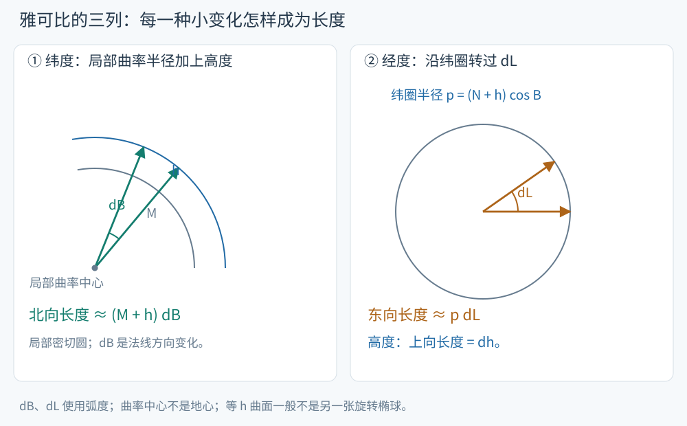

# 坐标微分：方向基与长度标尺

纬度增加 $0.2''$、经度增加 $0.3''$、高度增加 5 m，会让 XYZ 各改变多少？完整正算相减能得到精确差值，微分公式则直接说明每一种变化产生的位移方向和长度。本页对应 S10 第5–6页及第10页题2–3。

<!-- source-figure: {"src": "/geodesy/figures/differential-scales.svg", "alt": "纬度、经度与高度的三个长度标尺", "source": "本站绘制", "page": "示意图", "original": true} -->

纬度、经度与高度的三个长度标尺。来源：本站绘制，示意图。 左图的 M 从局部曲率中心量起，h 沿法线增加，所以北向标尺为 M+h；右图从地轴量纬圈半径，得到 $(N+h)\cos B$。两种角都用弧度。图为局部几何示意，等 h 曲面一般不是另一张旋转椭球。
<!-- /source-figure -->

先把三种变化分开。只改高度时，位置沿上向移动 $dh$；只改纬度时，椭球脚点产生 $M\,dB$ 的北向位移，而抬高的法线随 B 转动又贡献 $h\,dB$；只改经度时，点沿半径 $(N+h)\cos B$ 的纬圈移动。三个独立变化相加，才组成完整微分。

单位方向的几何构造见[局部方向](geodesy-local-directions.md#先构造方向，再使用方向余弦)。下面将它们写成分量，便于直接计算。

## 把微分看成三个方向的位移相加

在 B、L 处定义北、东、上单位向量

$$
\mathbf e_N=\begin{pmatrix}-\sin B\cos L\\-\sin B\sin L\\\cos B\end{pmatrix},\quad
\mathbf e_E=\begin{pmatrix}-\sin L\\\cos L\\0\end{pmatrix},\quad
\mathbf e_U=\begin{pmatrix}\cos B\cos L\\\cos B\sin L\\\sin B\end{pmatrix}.
$$

它们彼此正交，长度均为 1。$M=a(1-e^2)/W^3$、$N=a/W$ 分别为子午圈与卯酉圈曲率半径。坐标微分为

$$
\boxed{d\mathbf r=(M+h)\mathbf e_N\,dB
 +(N+h)\cos B\,\mathbf e_E\,dL
 +\mathbf e_U\,dh.}
$$

纬度的单位变化对应北向长度 $M+h$，经度的单位变化对应东向长度 $(N+h)\cos B$，高度变化本身就是上向长度。角微分 dB、dL 必须用弧度。

## 雅可比分解为“方向 × 标尺”

记 $\mathbf q=(B,L,h)^T$，将三个单位方向按北、东、上排成列矩阵

$$
A=[\mathbf e_N\ \mathbf e_E\ \mathbf e_U],\qquad
D=\operatorname{diag}(M+h,(N+h)\cos B,1).
$$

则

$$
\boxed{d\mathbf r=J_{\mathbf r\mathbf q}\,d\mathbf q,\qquad
J_{\mathbf r\mathbf q}=AD.}
$$

课件将对角标尺记为 J，将完整雅可比写成 AJ；这里用 D 表示标尺，使“雅可比”与“对角阵”的含义清楚。A 满足 $A^TA=I$，但列顺序 NEU 是左手顺序，$\det A=-1$。正交性足以给出逆矩阵 $A^{-1}=A^T$；行列式的符号在下一章旋转向量中会用到。

由于 $D^{-1}$ 容易计算，反向微分立即得到

$$
\boxed{\begin{aligned}
dB&=\frac{-\sin B\cos L\,dX-\sin B\sin L\,dY+\cos B\,dZ}{M+h},\\
dL&=\frac{-\sin L\,dX+\cos L\,dY}{(N+h)\cos B},\\
dh&=\cos B\cos L\,dX+\cos B\sin L\,dY+\sin B\,dZ.
\end{aligned}}
$$

几何上，先将 dXYZ 投影到北、东、上，再分别除以每弧度对应的长度。极点 $\cos B=0$，经度参数退化，应改用局部直角分量或另选坐标图。

> [!info]- 完整求导：为什么偏导恰好沿北、东、上？
> 从 $\mathbf r=\mathbf r_0+h\mathbf e_U$ 出发。先求
>
> $$
> N_B=\frac{Ne^2\sin B\cos B}{W^2},\qquad
> M=\frac{N(1-e^2)}{W^2}.
> $$
>
> 于是
>
> $$
> \begin{aligned}
> \frac{d(N\cos B)}{dB}
> &=N_B\cos B-N\sin B=-M\sin B,\\
> \frac{d[N(1-e^2)\sin B]}{dB}
> &=(1-e^2)(N_B\sin B+N\cos B)=M\cos B.
> \end{aligned}
> $$
>
> 这给出 $\partial_B\mathbf r_0=M\mathbf e_N$。另有
>
> $$
> \partial_B\mathbf e_U=\mathbf e_N,\qquad
> \partial_L\mathbf r_0=N\cos B\,\mathbf e_E,\qquad
> \partial_L\mathbf e_U=\cos B\,\mathbf e_E.
> $$
>
> 固定 h 求偏导：
>
> $$
> \partial_B\mathbf r=(M+h)\mathbf e_N,\quad
> \partial_L\mathbf r=(N+h)\cos B\,\mathbf e_E,\quad
> \partial_h\mathbf r=\mathbf e_U.
> $$
>
> 三列并排即为雅可比。其第一、二列单位是 m/rad，第三列是 m/m，乘上对应微分后统一为米。

## 讲义例题：角秒变化如何成为三维位移

沿用[正算页](geodesy-coordinate-forward.md)的克拉索夫斯基椭球和测站，取

$$
\Delta B=0.2'',\quad\Delta L=0.3'',\quad\Delta h=5\ \mathrm m.
$$

先用 $1''=\pi/648000\ \mathrm{rad}$ 转角度。在例点有 $M=6352929.620348$ m、$N=6384071.009477$ m，故三种变化先形成局部北、东、上位移，约为 $(6.16007949,7.91955424,5)$ m。再分别乘三个单位方向并相加，由雅可比得到

$$
\boxed{\Delta\mathbf r_{\rm lin}=
(-7.298644290,\ -3.247850160,\ 7.864297773)^T\ \mathrm m.}
$$

把变化后的 BLH 重新正算再相减，则得

$$
\Delta\mathbf r_{\rm exact}=
(-7.298639914,\ -3.247860206,\ 7.864300373)^T\ \mathrm m.
$$

精确差值减一阶结果，三分量约为 $(0.00438,-0.01005,0.00260)$ mm。这些差来自微分中省去的二阶项。对本例的角秒和米级变化，一阶结果已把变化量表达得很精细；更大位移可直接完整正反算。

## 与站心基线的区别：U 不恒等于有限高度差

将本章测站作为起点，沿固定起点 NEU 基加入 $(400,300,500)$ m，所得 XYZ 基线是 $(-369.515374244,28.607181484,602.195995806)^T$ m。用同一椭球精确反算终点，椭球高由108.391 m变为约608.410639528 m，即

$$
U=500\ \mathrm m,\qquad \Delta h=500.019639528\ \mathrm m.
$$

约19.64 mm的差异来自有限位移后的法线和参考面几何。站心基线在固定正交基中的投影是精确的，$dh=\mathbf e_U^Td\mathbf r$ 则是一阶微分关系。两者使用相同方向，但描述的量不同。

## 球近似与长度微元

S10 第10页题3令 $e^2=0,a=R$，于是 M=N=R：

$$
d\mathbf r=(R+h)\mathbf e_N dB
+(R+h)\cos B\,\mathbf e_E dL+\mathbf e_U dh.
$$

正交性使长度平方直接相加：

$$
ds^2=(M+h)^2dB^2+(N+h)^2\cos^2B\,dL^2+dh^2.
$$

h=0 时就是椭球面的第一基本形式。它解释了相同经度差在高纬度对应较短的东西向距离。

## 自检

1. 为什么同为 $1''$，纬度变化和经度变化对应的长度通常不同？
2. 若局部位移恰为上向 2 m，dB、dL、dh 分别是多少？
3. 将角秒值 0.2、0.3 直接代入雅可比，会出现什么量级的错误？

> [!info]- 展开答案
> 1. 每弧度长度分别为 M+h 与 $(N+h)\cos B$，既受曲率半径影响，也受经线向极点汇聚影响。
> 2. 一阶关系为 $(0,0,2\ \mathrm m)$；同一条法线上的有限高度变化也满足 B、L 不变。
> 3. 角秒需要除以约 206264.806 才是弧度。直接代入会把两个角变化产生的位移放大约 206265 倍。

继续：[椭球参数变化](geodesy-ellipsoid-parameter-change.md) · 返回[第五章](geodesy-coordinate-conversion.md)。
