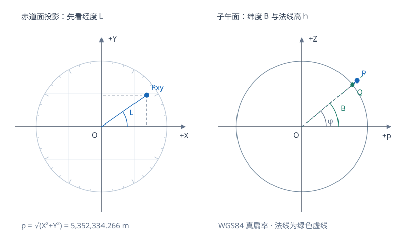
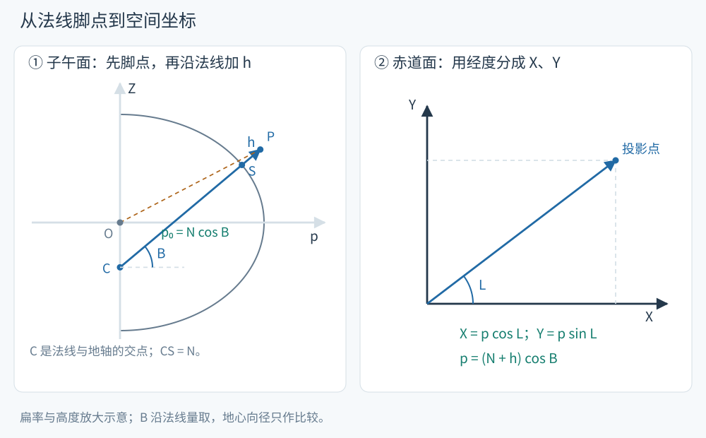
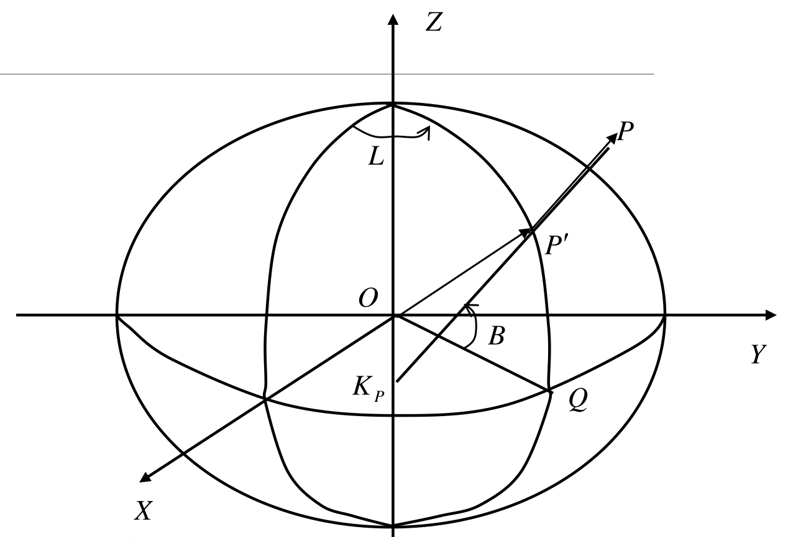

# 正算：由大地经纬高求空间坐标

拿到测站的大地纬度 B、经度 L 和椭球高 h，怎样求出三维直角坐标？几何上只需做两件事：在椭球面上找到法线脚点，再沿这条法线走 h 米。本页对应 S10《4大地坐标与地心坐标之间转.pdf》第2–3页及第10页题1。

<!-- geodesy-interactive: blh-xyz | 同一点的BLH与XYZ | lab-blh-xyz.svg -->

先看子午面上的法线与地心向径，再看赤道面的经度投影；增加 h 时点沿同一法线移动。本站按正算模型绘制。

[离线打开交互图](../assets/interactive/blh-xyz.html)

## 先把坐标的含义固定下来

空间直角系的 Z 轴沿椭球短轴，X 轴位于赤道面与起始子午面的交线上，Y 轴补成右手系。B 是椭球外法线与赤道面的夹角，L 从 X 轴所在子午面向东量取。h 从椭球面沿外法线计量。

这里的 h 是椭球高。水准测得的正常高需要结合高程异常才能换成椭球高。以椭球中心建立的直角系在与地心地固框架相容定义时才可直接称为相应的 ECEF；坐标计算同时需要明确采用的椭球和参考框架。

定义

$$
e^2=\frac{a^2-b^2}{a^2}=2f-f^2,\qquad
W=\sqrt{1-e^2\sin^2B},\qquad N=\frac aW.
$$

N 是卯酉圈曲率半径。全部三角函数以弧度为输入，长度使用同一单位。

<!-- source-figure: {"src": "/geodesy/figures/coordinate-meridian.svg", "alt": "法线脚点、椭球高与经度分解", "source": "本站绘制", "page": "示意图", "original": true} -->

先在子午面找到脚点 S，再沿法线走 h，最后在赤道面按 L 分成 X、Y。CS 的长度为 N，地心到脚点的距离通常不等于 N。本站按正算模型绘制，扁率和高度放大。
<!-- /source-figure -->

## 法线脚点加上高度

先在子午面中令脚点的水平距离为 $p_0$、竖坐标为 $Z_0$。截面椭圆满足

$$
\frac{p_0^2}{a^2}+\frac{Z_0^2}{b^2}=1.
$$

外法线沿 $(p_0/a^2,Z_0/b^2)$，所以在非极点处

$$
\tan B=\frac{a^2Z_0}{b^2p_0},\qquad
Z_0=(1-e^2)p_0\tan B.
$$

将后一式代入椭圆方程，取 $p_0\geq0$，便得到 $p_0=a\cos B/W=N\cos B$，进而有 $Z_0=N(1-e^2)\sin B$。这个因子来自椭圆形状与法线方向的关系。极点直接取 $p_0=0,Z_0=\pm b$。

再用经度把 $p_0$ 分到 X、Y 轴，椭球面的脚点 P₀ 具有坐标

$$
\mathbf r_0=
\begin{pmatrix}
N\cos B\cos L\\N\cos B\sin L\\N(1-e^2)\sin B
\end{pmatrix}.
$$

沿外法线的单位向量为

$$
\mathbf e_U=
\begin{pmatrix}\cos B\cos L\\\cos B\sin L\\\sin B\end{pmatrix}.
$$

于是实际空间点是 $\mathbf r=\mathbf r_0+h\mathbf e_U$，展开得

$$
\boxed{
\begin{aligned}
X&=(N+h)\cos B\cos L,\\
Y&=(N+h)\cos B\sin L,\\
Z&=[N(1-e^2)+h]\sin B.
\end{aligned}}
$$

Z 中的 $1-e^2=b^2/a^2$ 来自椭球面形状；h 对三轴的贡献来自同一条单位法线。将高度简单加到地心距离上会采用不同的移动方向。

> [!info]- 完整推导：椭球面坐标为什么是这个形式？
> 将椭球写为
>
> $$
> F(X,Y,Z)=\frac{X^2+Y^2}{a^2}+\frac{Z^2}{b^2}-1=0.
> $$
>
> 梯度 $\nabla F=2(X/a^2,Y/a^2,Z/b^2)^T$ 沿外法线。令脚点的法线单位向量为 $\mathbf e_U$，存在正数 k，使
>
> $$
> X_0=ka^2\cos B\cos L,\quad
> Y_0=ka^2\cos B\sin L,\quad
> Z_0=kb^2\sin B.
> $$
>
> 代回椭球方程：
>
> $$
> k^2(a^2\cos^2B+b^2\sin^2B)=1.
> $$
>
> 利用 $b^2=a^2(1-e^2)$ 得 $k=1/(aW)$。故 $ka^2=a/W=N$，$kb^2=N(1-e^2)$，得到上面的脚点表达。这同时说明，B 来自法线而非地心向径；两者只在赤道、极点或球面情况下重合。

<!-- source-figure: {"src": "/geodesy/figures/source-blh-normal.png", "alt": "课件中的脚点与法线高度", "source": "S10 大地坐标与地心坐标之间转", "page": "3", "locator": "PDF 文件页 3"} -->

来源：S10，PDF 文件页3，截取右侧几何图。原课件用 H 表示本文的 h；P′ 对应脚点，P 对应空间点。沿 P′P 的高度分量分别是 $h\cos B$ 和 $h\sin B$，可与正算式逐项对应。
<!-- /source-figure -->

## 手算流程与讲义例题

采用克拉索夫斯基椭球 $a=6378245\ \mathrm m$、$f=1/298.3$，有 $e^2=0.006693421622966$。S10 第10页给出

$$
B=31^\circ28'16.2831'',\quad L=121^\circ31'50.4015'',\quad h=108.391\ \mathrm m.
$$

先将角度转为十进制度：$B=31.47118975^\circ$、$L=121.530667083333^\circ$，再乘 $\pi/180$ 转为弧度。代入得 $W=0.999087414681329$、$N=6384071.009477\ \mathrm m$。于是水平半径为 $(N+h)\cos B$，分别乘 $\cos L,\sin L$ 得 X、Y；竖直分量使用 $[N(1-e^2)+h]\sin B$，可得

$$
\boxed{\begin{aligned}
X&=-2847533.340846\ \mathrm m,\\
Y&= 4641174.204265\ \mathrm m,\\
Z&= 3310678.314420\ \mathrm m.
\end{aligned}}
$$

点位于北半球、东经第二象限，所以 $Z>0,X<0,Y>0$。这个符号检核在按计算器前就能完成。[下一页的反算](geodesy-coordinate-inverse.md)将用这些结果找回原来的经纬高。

## 三个边界检核

赤道与起始子午线交点：$B=L=h=0$，应得 $(a,0,0)$。北极：$B=90^\circ,h=0$，应得 $(0,0,b)$。球面：$e^2=0,N=a$，公式化为半径 $a+h$ 的球坐标公式。

这些检核分别检查轴向、高度方向与椭球扁率项。极点的 L 可以任意指定，所有经线在该点汇合。

## 自检

1. $B=0,L=90^\circ,h=20\ \mathrm m$ 时，三轴坐标是多少？
2. 若只令 h 增加 1 m，空间位移长度是多少？方向是什么？
3. 能否用 $Z=(N+h)\sin B$ 替代原公式？哪些条件下成立？

> [!info]- 展开答案与理由
> 1. $(0,a+20,0)$。在赤道 N=a，点沿 Y 轴。
> 2. $\Delta\mathbf r=\mathbf e_U\times1\ \mathrm m$，长度恰为 1 m，方向是脚点的椭球外法线。
> 3. 相差 $Ne^2\sin B$。球面 $e^2=0$ 或赤道 $\sin B=0$ 时成立；一般椭球纬度下需要保留扁率项。

继续：[XYZ 反算 BLH](geodesy-coordinate-inverse.md) · 返回[第五章](geodesy-coordinate-conversion.md)。
