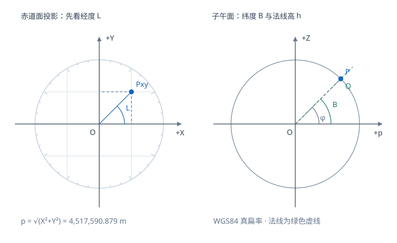
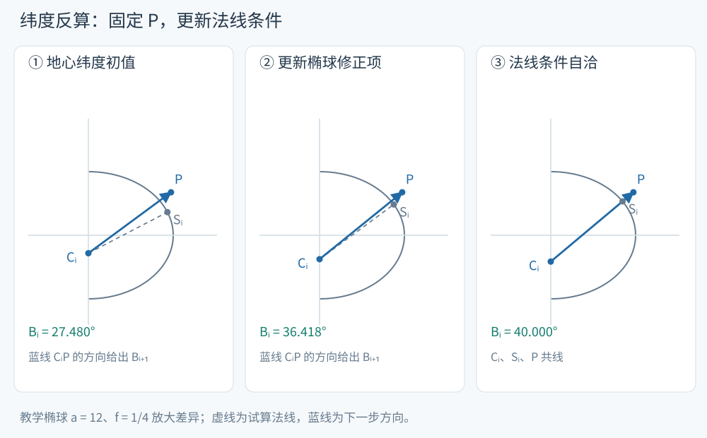

# 反算：由空间坐标找回经纬高

经度由 XY 平面中的方向直接确定；大地纬度还要找到椭球法线，所以含有随 B 改变的曲率半径 N。S10 第4页给出迭代解法，本页保留它的几何路线，并补齐象限、极点和高度计算的数值处理。




<!-- geodesy-interactive: inverse | 从XYZ定位法线脚点 | lab-inverse.svg -->

从 XY 投影先确定子午面，再在子午面寻找法线脚点；高度沿法线计量。交互的读数采用其面板所列椭球与迭代设置。本站绘制。

[离线打开交互图](../assets/interactive/inverse.html)

## 经度先用两个坐标一起判断象限

令 $p=\sqrt{X^2+Y^2}=\operatorname{hypot}(X,Y)$。由正算公式消去共同因子得

$$
\boxed{L=\operatorname{atan2}(Y,X).}
$$

atan2 的两个输入同时保留 X、Y 的符号。讲义中的 $\arctan(Y/X)$ 适合结合象限讨论使用；直接在程序中写单参数 arctan 会让相差 $180^\circ$ 的两点得到同一结果。$\arcsin(Y/p)$ 也需要补充象限。

经度可以存为 $(-180^\circ,180^\circ]$ 或 $[0^\circ,360^\circ)$；转换时只是周期归一化。X=Y=0 时处于极轴，经度没有唯一值。

## 纬度迭代从哪里来

正算公式给出 $p=(N+h)\cos B$ 与 $Z=[N(1-e^2)+h]\sin B$。用后式加上 $e^2N\sin B$，可得

$$
Z+e^2N\sin B=(N+h)\sin B=p\tan B.
$$

因此采用讲义的迭代形式

$$
\begin{aligned}
B_0&=\operatorname{atan2}(Z,p),\\
N_i&=\frac a{\sqrt{1-e^2\sin^2B_i}},\\
\boxed{B_{i+1}}&\boxed{=\operatorname{atan2}(Z+e^2N_i\sin B_i,p).}
\end{aligned}
$$

初值 $B_0$ 是地心纬度。每轮先按试算纬度计算 N，再更新法线条件；空间点本身保持固定。近地面常用椭球上收敛很快。实现时设置角差阈值和最大迭代次数，并在退出后做正算闭合检核。这里的算法面向地表及其附近的常规测量点，椭球深部法线坐标的多解情况需另作分析。

在子午面中，试算法线与地轴的交点是 $C_i=(0,-e^2N_i\sin B_i)$。从 $C_i$ 指向固定点 $P=(p,Z)$ 的方向角，正好就是下一次的 $B_{i+1}$。收敛时，这条连线与试算法线一致；中间迭代的连线还不一定是试算脚点的法线。

<!-- source-figure: {"src": "/geodesy/figures/inverse-steps.svg", "alt": "固定测站与法线条件的迭代更新", "source": "本站绘制", "page": "示意图", "original": true} -->


固定测站与法线条件的迭代更新。来源：本站绘制，示意图。 三幅图中的 P 不动，改变的是 Cᵢ 与试算法线。蓝线 CᵢP 给出下一轮方向，虚线给出当前试算法线；末幅两者重合。图使用放大扁率的教学椭球，数值例题仍采用克拉索夫斯基椭球。
<!-- /source-figure -->

> [!info]- 可直接实现的伪代码与收敛判据
> ```text
> p = hypot(X, Y)
> if p == 0:
>     if Z == 0: 返回“地心无唯一法线经纬高”
>     B = sign(Z) * pi/2
>     L = 约定值，并标记经度未定义
>     h = abs(Z) - b
> else:
>     L = atan2(Y, X)
>     B = atan2(Z, p)
>     repeat 最多30次:
>         N = a / sqrt(1 - e2*sin(B)^2)
>         Bnew = atan2(Z + e2*N*sin(B), p)
>         delta = abs(Bnew - B)
>         B = Bnew
>         if delta < 1e-14 rad: break
>     W = sqrt(1-e2*sin(B)^2)
>     h = p*cos(B) + Z*sin(B) - a*W
> ```
>
> 收敛阈值 $10^{-14}$ rad 对应地球尺度约 $0.06\ \mu\mathrm m$ 的弧长；实际精度还受输入舍入和浮点计算影响。常规工程可按任务需要放宽阈值。若达到迭代上限仍未满足阈值，返回状态而不是把最后一次值当成已收敛结果。


## 高度计算为什么要照顾极区

讲义给出两种等价形式：

$$
h=\frac p{\cos B}-N
=\frac Z{\sin B}-N(1-e^2).
$$

第一式在极区除以很小的 $\cos B$；第二式在赤道附近除以很小的 $\sin B$。一种做法是按纬度选用分母较大的公式。另一个统一表达来自沿法线投影：

$$
\boxed{h=p\cos B+Z\sin B-aW.}
$$

这一步的几何含义可以直接写成 $\mathbf r\cdot\mathbf e_U=\mathbf r_0\cdot\mathbf e_U+h=aW+h$：先把空间位置沿单位法线投影，再减去脚点的同向投影。$aW$ 是投影长度，并非地心到脚点的距离。

> [!info]- 推导：不用除以 sin B 或 cos B 的高度式
> 将正算两式分别乘 $\cos B,\sin B$ 后相加：
>
> $$
> \begin{aligned}
> p\cos B+Z\sin B
> &=(N+h)\cos^2B+[N(1-e^2)+h]\sin^2B\\
> &=h+N(1-e^2\sin^2B)\\
> &=h+NW^2=h+aW.
> \end{aligned}
> $$
>
> 这一表达消除了极区的小分母。由于高度通常由两个数百万米的量相减得到，仍应保留足够的浮点精度；双精度适合常规地球坐标计算。


## 算例：闭合到原来的 BLH

输入[正算页](geodesy-coordinate-forward.md)的未截断 XYZ 和克拉索夫斯基椭球参数，先求 p 与 L，再反复更新 N 和 B：

| 迭代编号 i | $B_i$（度） |
|---|---:|
| 0（地心纬度） | 31.300116055659 |
| 1 | 31.470354512001 |
| 2 | 31.471185675774 |
| 3 | 31.471189730126 |
| 4 | 31.471189749903 |
| 5 | 31.471189750000 |

收敛后得

$$
B=31.47118975^\circ=31^\circ28'16.2831'',\quad
L=121.530667083333^\circ=121^\circ31'50.4015'',
$$

$$
h=108.390999999829\ \mathrm m.
$$

将反算所得 BLH 再正算，三维闭合差小于 $10^{-7}\ \mathrm m$。若使用页面显示的六位小数 XYZ，结果应在相应舍入精度内闭合。这个例子还检查了经度第二象限：单参数 arctan 会给出约 $-58.4693^\circ$，而 atan2 返回正确的 $121.5307^\circ$。

## 手算表与交互读数怎样对应

本页手算表和伪代码使用地心纬度初值、最多30次及 $10^{-14}$ rad 角差阈值。交互默认使用 WGS84，采用 $\operatorname{atan2}(Z,p(1-e^2))$ 加速初值、最多100次及 $2\times10^{-15}$ rad 阈值；因此它的迭代次数不应直接与上表比较。两者求解同一法线条件，使用相同椭球和输入后，最终坐标应在浮点与输入舍入精度内闭合。交互还明确限定归一化半径不小于0.99的教学域。

## 自检

1. X<0、Y>0 的点，经度通常位于哪个象限？为什么 $\arctan(Y/X)$ 会出错？
2. 北极点坐标 $(0,0,b+10)$ 的 B、h 是多少？L 怎么处理？
3. 能否直接令 $B=\operatorname{atan2}(Z,p)$ 后结束计算？

> [!info]- 展开答案
> 1. 经度在 $90^\circ$ 到 $180^\circ$ 之间。比值 Y/X 为负，单参数 arctan 的主值落在第四象限。
> 2. $B=90^\circ,h=10\ \mathrm m$；L 无唯一值，可按软件约定赋 0，同时保留“经度未定义”的状态。
> 3. 这个角是地心纬度。球面、赤道、极点等情况下与大地纬度重合，一般椭球点需要继续求法线方向。


继续：[坐标微分](geodesy-coordinate-differentials.md) · 返回[第五章](geodesy-coordinate-conversion.md)。
