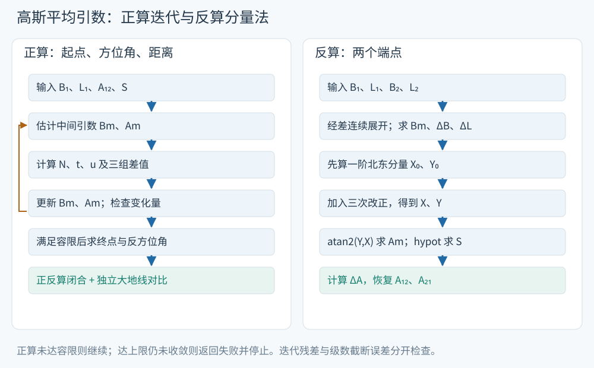

# 大地主题正算与反算

用同一组输入走完正算和反算，逐步辨认引数更新、象限处理和误差回验。需要上一页的三次公式；所有内部角度使用弧度。


<!-- earth-reading-task -->
把S8的同一组数据一直用到结束：B1=40°00′08.3421″、L1=115°46′27.0953″、A12=75°41′29.762″、S=24909.814m。原题未指定椭球，本页演示明确用WGS84。先估中间引数、更新终点，再检查迭代残差和独立位置差；两种误差必须分开读。
<!-- /earth-reading-task -->

<!-- source-figure: {"src": "/geodesy/figures/gauss-flow.svg", "alt": "高斯平均引数正算与反算流程", "source": "本站绘制", "page": "示意图", "original": true} -->


来源依据：S9，PDF 文件页28–29及本页完整三次式，本站重绘。左侧正算更新未知中间引数；右侧反算先从已知端点形成北东分量，再用 atan2 和模长。正反算闭合检查程序一致性，独立算法对比检查级数截断误差。
<!-- /source-figure -->

## 三组高斯平均引数公式

沿用上页定义：$B_m=(B_1+B_2)/2$，$L_m=(L_1+L_2)/2$，$A_m=(A_{12}+A_2^+)/2$，各角先在连续分支上展开。令 $t=\tan B_m$、$u=e'^2\cos^2B_m$、$V^2=1+u$、$N=N(B_m)$。注意 $N_m=N(B_m)$，不是 $(N_1+N_2)/2$；后者差异会影响三次项。为减轻长式阅读，把三组无量纲系数单独列出：

$$
\begin{aligned}
C_B={}&\sin^2A_m(2+3t^2+2u)\\
&+3u\cos^2A_m(-1+t^2-u-4t^2u),\\
C_L={}&t^2\sin^2A_m-\cos^2A_m(1+u-9t^2u),\\
C_A={}&\sin^2A_m(2+t^2+2u)\\
&+\cos^2A_m(2+7u+9t^2u+5u^2).
\end{aligned}
$$

于是原讲义 S8 文件页23的正算式等价于

$$
\boxed{\Delta B=\frac{SV^2\cos A_m}{N}\left(1+\frac{S^2C_B}{24N^2}\right),}
$$
$$
\boxed{\Delta L=\frac{S\sin A_m}{N\cos B_m}\left(1+\frac{S^2C_L}{24N^2}\right),}
$$
$$
\boxed{\Delta A=\frac{St\sin A_m}{N}\left(1+\frac{S^2C_A}{24N^2}\right).}
$$

公式保留到端点差的三次项。课件称“四次方精度”，来自对称展开中四次差值项抵消、下一项为五次；这是阶次描述，不是一个适用于所有纬度、距离、方向的误差上限。

## 正算：为什么需要迭代

已知起点、$A_{12}$ 和 $S$ 时，$B_m,A_m$ 尚含未知终点。先用起点一阶导数估计

$$
B_m^{(0)}=B_1+\frac{S\cos A_{12}}{2M_1},\qquad
A_m^{(0)}=A_{12}+\frac{S\tan B_1\sin A_{12}}{2N_1}.
$$

然后依次计算 $N,t,u,V^2$ 与三组差值，再更新

$$
B_m^{(k+1)}=B_1+\frac{\Delta B^{(k)}}2,\qquad
A_m^{(k+1)}=A_{12}+\frac{\Delta A^{(k)}}2.
$$

重复至纬度和方位角引数变化均小于选择的容限。S8 文件页24给出 $0.0001''$，换成弧度约 $4.8481\times10^{-10}$；实现还应设迭代次数上限并报告不收敛。获得引数后重算三组差值，最后

$$
B_2=B_1+\Delta B,\quad L_2=L_1+\Delta L,\quad
A_{21}=(A_{12}+\Delta A+\pi)\bmod2\pi.
$$

经度输出可以归一到 $[-\pi,\pi)$，但差值和平均值使用展开后的经度。收敛容限控制的是迭代残差；大地线近似误差和坐标输入误差仍需另验。

## 反算：先得到北东分量，再求角和距离

已知端点，先得到 $\Delta B,\Delta L,B_m$，其中短线跨180°经线时使用局部连续的经度差。定义一阶分量

$$
X_0=\frac{N\Delta B}{1+u},\qquad Y_0=N\cos B_m\Delta L.
$$

把 $X=S\cos A_m$、$Y=S\sin A_m$ 代入正算式，解出其三次改正；右侧小量项可以用 $X_0,Y_0$ 代替 $X,Y$，差异只影响更高次项。得到不再截断椭球辅助量的三次反解：

$$
\begin{aligned}
X={}&X_0-\frac{X_0}{24N^2}\big[Y_0^2(2+3t^2+2u)\\
&\hspace{27mm}+3uX_0^2(-1+t^2-u-4t^2u)\big],\\
Y={}&Y_0-\frac{Y_0}{24N^2}\big[t^2Y_0^2-X_0^2(1+u-9t^2u)\big].
\end{aligned}
$$

这样求出 $A_m=\operatorname{atan2}(Y,X)$、$S=\sqrt{X^2+Y^2}$。`atan2`同时使用分量的正负确定象限；只用 $\arctan(Y/X)$ 会失去象限且在 $X=0$ 时不能相除。用分量模长也避免了原讲义 $S=Y/\sin A_m$ 在纯子午线时的零除。

将 $S,A_m$ 代回正算第三式，求 $\Delta A$，再得

$$
A_{12}=(A_m-\Delta A/2)\bmod2\pi,\qquad
A_{21}=(A_m+\Delta A/2+\pi)\bmod2\pi.
$$

当两端重合时 $S=0$，方位角无定义，应明确返回此状态。近极点、近对跖点或长距离问题超出这套局部级数的可靠范围，应用完整椭球大地线算法。

> [!info]- 原课件反算多项式与辅助量截断的对应
> S8 文件页25先用一阶 $S\cos A_m,S\sin A_m$ 代入小量项，页26进一步整理为以下多项式。记 $b=\Delta B,l=\Delta L$：
>
> $$
> X\simeq\frac{Nb}{1+u}
> -\frac{N\cos^2B_m}{24}(2+3t^2-3t^2u)bl^2
> -\frac N8(t^2u-u)b^3,
> $$
> $$
> Y\simeq N\cos B_m\,l
> +\frac{N\cos B_m}{24}(1-u-9t^2u)b^2l
> -\frac{N\cos B_m\sin^2B_m}{24}l^3.
> $$
>
> 它们还在三次项的系数中省略了 $u^2$ 及更高项；第一项的 $1/(1+u)$ 保留原样。例如完整反解中的混合项系数
>
> $$
> \frac{2+3t^2+2u}{1+u}=2+3t^2-3t^2u+O(u^2),
> $$
> $$
> \frac{1+u-9t^2u}{(1+u)^2}=1-u-9t^2u+O(u^2).
> $$
>
> 剩下的 $b^3$ 项同样展开到 $u$ 的一次。由 $\cos^2B_m\,t^2=\sin^2B_m$ 可得到末尾 $l^3$ 项。这解释了原件两页之间的进一步简化，不应把课件最终式误标为“完全保留偏心率的三次反解”。本页计算演示使用上面的完整三次反解，原课件最终式也保留供核对。


<!-- geodesy-anchor: gauss-example -->
## 计算演示与精度回验
程序与数值结果见[独立核验记录](../data/new-lectures-verification.json)。采用WGS84几何参数，仅演示方法，不推定原讲义算例属于这个椭球。对实际项目需使用指定参考椭球和框架。

> [!info]- 使用原讲义末页数据走完一次正算、反算和边长归算
> S8 文件页28的大地主题数据为 $B_1=40^\circ00'08.3421''$、$L_1=115^\circ46'27.0953''$、$A_{12}=75^\circ41'29.762''$、$S=24909.814\,\mathrm m$。按“度+分/60+秒/3600”转换后再转弧度，执行本页正算，再用所得端点反算。结果和与GeographicLib的差值记录在[数值表](../data/new-lectures-verification.json)的 `lecture_example` 中。原页未在该处明确椭球，本演示明确选WGS84，不能冒充唯一原题答案。
>
> 同页边长数据是 $D=28678.456\,\mathrm m$、$B_1=38^\circ22.3'$、$A_{12}=56^\circ38.6'$、$B_2=38^\circ30.6'$、$A_{21}=236^\circ45.6'$、$H_1=4130.46\,\mathrm m$、$H_2=3950.67\,\mathrm m$。原题的 $H_1,H_2$ 对应归算页的端点椭球高 $h_1,h_2$。原题采用小数角分记号，例如“$22'.3$”表示 $22.3'$，即 $22'18''$；输入按“度+小数角分/60”转换。先求两端方向半径，再按上一页的斜距归算公式算 $d$，用平均方向半径完成弦弧转换。记录分别列出一阶工程式、局部曲率圆式及二者差异；这里曲率圆公式的“精确”仅相对于该局部模型，不能作为严格椭球归算精度。
>
> 原习题的要求与数据完整保留在[原PDF](https://langwangluoji.github.io/study-space/geodesy-source-s8.html)；本页的简短自测用于检查公式条件与结果解释。


### 数值结果

所有结果采用WGS84；原题未指定椭球，不能直接用本表替代其他椭球的答案。

终点纬度 **40.0574161638°**，经度 **116.0570868074°**，反方位角 **255.8735542790°**。迭代5次（核验脚本以两个中间引数变化的最大值小于 $10^{-14}$ rad 为停止条件，最多100次）；反算距离 **24909.814000m**；与完整算法的终点位置差约 **0.000058mm**。

斜距算例：局部模型弦长 **28659.737323m**，曲率圆弧长 **28659.761432m**；一阶工程式 **28659.749978m**，二者差 **-11.454mm**。该差主要反映一阶高度截断等近似，曲率圆弧长也不是严格的椭球归算真值。

以下是六个纬度、八个方位角（包含南北东西、四象限和跨180°经线）的抽样最大误差，**不是全域误差上限**。

|距离|纬度范围|正算终点位置差|反算距离差|
|---|---|---|---|
|1km|绝对纬度≤60°|0.0000mm|0.0000mm|
|1km|绝对纬度≤80°|0.0000mm|0.0000mm|
|25km|绝对纬度≤60°|0.0003mm|0.0001mm|
|25km|绝对纬度≤80°|0.0290mm|0.0024mm|
|100km|绝对纬度≤60°|0.3554mm|0.0518mm|
|100km|绝对纬度≤80°|33.8606mm|2.4068mm|
|200km|绝对纬度≤60°|12.1922mm|1.6849mm|
|200km|绝对纬度≤80°|1344.5056mm|88.9510mm|

极区和较长线的误差会显著增长；按任务精度选择完整算法。迭代容限只能约束迭代变化，不能消除这些截断误差。


验算分三层：先用符号计算检查三次系数与微分方程是否相同；再用直接数值积分检查单位速度及克莱劳守恒；最后与完整椭球大地线算法比较有限距离的位置与方向。正反算互相接近只能说明同一套公式内部一致，不能单独证明没有共同的截断误差。

核验覆盖球面极限、赤道、南北半球、子午/东西/斜向、四个象限、跨180°经线，以及随距离增大的误差。越靠近极点，$\tan B$ 和 $1/\cos B$ 越大，不能仅凭“距离小于200km”保证精度。若实际精度要求更严，应根据独立误差结果改用完整算法。

[原文定位：S8 文件页23–28](https://langwangluoji.github.io/study-space/geodesy-source-s8.html)。

网页为串联原讲义补写了中间推导、符号约定与边界说明；完整原文和批注仍以所列文件页为准。

<!-- learning-mark: ge-gauss-solution -->

## 跟算与理解检查

### 完整例题：正反算分别交付什么

按原讲义数据输入 $B_1=40°00′08.3421″$、$L_1=115°46′27.0953″$、$A_{12}=75°41′29.762″$、$S=24909.814$ m。原题未标明椭球，本例明确取WGS84。先以“度+分/60+秒/3600”转为十进制度，再转弧度，按本页三次公式迭代，得到

$$
B_2=40.05741616375947°,
\quad L_2=116.05708680741117°,
\quad A_{21}=255.87355427897768°.
$$

以这两个端点作本页三次反算，恢复 $S=24909.813999981$ m、$A_{12}=75.691600555660°$。正反算一致检查公式内部关系；独立GeographicLib比较的本例终点差约 $5.82\times10^{-8}$ m。这个误差属于该输入与实现，精度范围仍结合正文的多距离、多纬度比较判断。

**自测1：迭代引数变化很小，说明最终大地线一定足够准确吗？**

> [!info]- 展开解析
> 引数变化说明所选截断公式的迭代稳定；还需检查截断误差，正文用独立积分和GeographicLib比较。

**自测2：反算两点重合时，距离与方位角分别是什么？**

> [!info]- 展开解析
> 距离为0，方位角无定义；应显式报告这一状态。


<!-- geodesy-anchor: gauss-pseudocode -->
## 从公式到伪代码
新版S9文件页28—29把正反算排成步骤。下面沿用本页的完整三次系数，`increments(Bm, Am, S)` 就是本页开头的三组增量公式，`Geo(B)` 依次返回 $N,M,t,u=e'^2\cos^2B,V^2$。这两个辅助函数的数学表达已在正文给出。所有角度为弧度，长度与长半轴同单位。

下列教学伪代码采用课件量级的容限：纬度引数 $0.0001''$、方位引数 $0.001''$，最多20次；同一算例在第3次更新满足条件。上面的数值表来自更严格的核验脚本，所以报告5次。次数都从第一次均值更新开始计；停止阈值、上限及初值一起规定后，迭代次数才可比较。两条路线的终点在本页显示精度内一致，容限与级数截断误差仍分开解释。

### 正算：更新均值，再重算终点

```text
输入 a, f, B1, L1, A12, S
(N1, M1, ...) ← Geo(B1)
Bm ← B1 + S cos(A12)/(2 M1)
Am ← A12 + S tan(B1) sin(A12)/(2 N1)
εB ← (0.0001/3600)π/180
εA ← (0.001/3600)π/180
converged ← false
重复 k = 1 ... 20：
    (ΔB, ΔL, ΔA) ← increments(Bm, Am, S)
    newB ← B1 + ΔB/2
    newA ← A12 + ΔA/2
    done ← |newB−Bm| ≤ εB 且 |newA−Am| ≤ εA
    (Bm, Am) ← (newB, newA)
    若 done：converged ← true；退出循环
若未 converged：
    返回“未收敛”状态；结束
(ΔB, ΔL, ΔA) ← increments(Bm, Am, S)
输出 B2 = B1 + ΔB
     L2 = wrapπ(L1 + ΔL)
     A21 = wrap2π(A12 + ΔA + π)
```

先把两个均值同时更新，再判断是否继续；最后按最终均值重算一次增量。`wrapπ` 将角度归入 $[-\pi,\pi)$，`wrap2π` 归入 $[0,2\pi)$。这些操作用于输出归一化或短线经差，均值迭代保留连续角度分支。

### 反算：一次三次反解，再恢复方位角

```text
输入 a, f, B1, L1, B2, L2
Bm ← (B1+B2)/2
ΔB ← B2−B1； ΔL ← wrapπ(L2−L1)
若 ΔB = 0 且 ΔL = 0：输出 S=0，方位角无定义；结束
(N, M, t, u, V²) ← Geo(Bm)
X0 ← M ΔB； Y0 ← N cos(Bm) ΔL
X ← X0 − X0[Y0²(2+3t²+2u)+3u X0²(−1+t²−u−4t²u)]/(24N²)
Y ← Y0 − Y0[t²Y0²−X0²(1+u−9t²u)]/(24N²)
Am ← atan2(Y, X)； S ← hypot(X, Y)
(忽略的纬差, 忽略的经差, ΔA) ← increments(Bm, Am, S)
输出 A12 = wrap2π(Am−ΔA/2)
     S
     A21 = wrap2π(Am+ΔA/2+π)
```

S9第29页采用原课件进一步省略辅助量高次项的反算多项式，对应本页“原课件反算多项式”折叠框；上面的伪代码采用完整三次反解。两种表达的截断层次在正文逐项对应。回验时按所选版本记录误差，保留原资料的算法约定。
