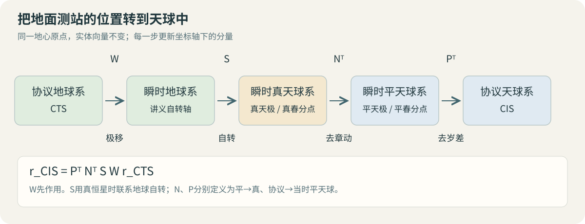

# 天球与地球参考系：坐标、旋转与转换链

参考系把同一个空间向量写成可计算的分量。定义坐标轴后，方向余弦阵负责分量转换；加入极移、自转、章动和岁差，就能把测站的地球坐标转到天球参考系。本页对应 S6 文件页 64–70、75–84，先掌握[地球运动](geodesy-orbit-earth-motion.md)和[时间尺度](geodesy-orbit-time-systems.md)。

## 定义坐标时要交代四件事

S6 第 64–66 页从不同角度分类坐标系统。直角、球、柱坐标属于表达方式；地心、站心、日心属于原点选择；惯性、非惯性描述参考系的运动性质。同一地心参考系可以同时采用直角和球坐标，坐标形式本身并不决定它是否惯性。

右手直角坐标系需要规定原点、基本平面与主轴。基本平面和正向法线规定 $z$ 轴，平面内主方向规定 $x$ 轴，最后由 $\mathbf e_x\times\mathbf e_y=\mathbf e_z$ 确定 $y$ 轴。原点平移与轴旋转是两种操作：向量分量转换由旋转阵描述；点坐标若采用不同原点，还需加入平移。

例如来源原点为 $O_Q$、目标原点为 $O_P$，同一点的位置满足

$$
\mathbf r^P=C^P_Q\mathbf r^Q+\mathbf d^P,
$$

$\mathbf d^P$ 是从 $O_P$ 指向 $O_Q$ 的位移在 $P$ 系中的分量。本页后续旋转公式采用共同地心原点。

## 方向余弦阵：先确定“从哪到哪”

设 $\mathbf A$ 的列分量在 $P,Q$ 系中分别为 $\mathbf A^P,\mathbf A^Q$。定义

$$
\mathbf A^P=C^P_Q\mathbf A^Q,
\qquad (C^P_Q)_{ij}=\mathbf e_i^P\cdot\mathbf e_j^Q.
$$

第 $j$ 列就是 $Q$ 系第 $j$ 根单位轴在 $P$ 系中的分量。这是 S6 第 67–68 页方向余弦法的核心。用列向量展开实体向量可直接验证：

$$
\mathbf A=\sum_j A^Q_j\mathbf e_j^Q,
\qquad
A^P_i=\mathbf e_i^P\cdot\mathbf A
=\sum_j(\mathbf e_i^P\cdot\mathbf e_j^Q)A^Q_j.
$$

因为两组基都正交归一，且方向保持右手性，

$$
(C^P_Q)^TC^P_Q=I,\qquad\det C^P_Q=+1,
\qquad C^Q_P=(C^P_Q)^T.
$$

若经过中间系 $R$，有

$$
C^P_Q=C^P_R C^R_Q.
$$

右边矩阵先作用。矩阵的上下标把计算顺序写清楚，避免用未说明方向的“旋转矩阵”代替完整定义。

## S6采用的被动旋转约定

被动旋转是坐标轴转动而实体向量保持不变。S6 第 69 页采用以下分量转换矩阵：

$$
M_x(\gamma)=\begin{bmatrix}
1&0&0\\0&\cos\gamma&\sin\gamma\\0&-\sin\gamma&\cos\gamma
\end{bmatrix},
$$

$$
M_y(\beta)=\begin{bmatrix}
\cos\beta&0&-\sin\beta\\0&1&0\\\sin\beta&0&\cos\beta
\end{bmatrix},
\quad
M_z(\alpha)=\begin{bmatrix}
\cos\alpha&\sin\alpha&0\\-\sin\alpha&\cos\alpha&0\\0&0&1
\end{bmatrix}.
$$

角的正向按对应轴右手规则规定。假设新坐标轴相对旧轴绕共同 $z$ 轴转 $+\alpha$，旧分量到新分量使用 $M_z(\alpha)$。若要求实体向量在固定轴下主动转 $+\alpha$，则使用它的转置 $M_z(-\alpha)$。

S6 第 70 页按逐次的轴 $Z\to Y\to X$，分别转 $\alpha,\beta,\gamma$，每步绕当时对应的轴完成分量转换，有

$$
C^B_A=M_x(\gamma)M_y(\beta)M_z(\alpha).
$$

矩阵一般不能交换。写“Z-Y-X欧拉角”时还应说明是逐次转动轴还是固定轴，以及主动或被动约定；这些条件共同决定数值矩阵。

## 天球的直角坐标与赤道球坐标

S6 第 75 页取 $z$ 轴指向天极、$x$ 轴指向春分点，采用地心距离 $r$、赤经 $\alpha$、赤纬 $\delta$：

$$
X=r\cos\delta\cos\alpha,\quad
Y=r\cos\delta\sin\alpha,\quad
Z=r\sin\delta.
$$

反解为

$$
r=\sqrt{X^2+Y^2+Z^2},\quad
\alpha=\operatorname{atan2}(Y,X),\quad
\delta=\operatorname{atan2}\left(Z,\sqrt{X^2+Y^2}\right).
$$

把 $\alpha$ 归入 $[0,2\pi)$ 后可换成小时。S6中 $\arctan(Y/X)$ 的简写需要补上象限判断，所以实际计算用atan2。目标恰在天极时赤经不唯一；在原点 $r=0$ 时方向本身未定义。

## 第80页的公式实际采用椭球大地坐标

地球坐标也可用球坐标表达，但 S6 第 80 页嵌入的公式含卯酉圈曲率半径 $N$ 和偏心率 $e$，对应的是椭球大地坐标。这里用 $h$ 表示椭球高，替代讲义图式中的 $H$：

$$
e^2=\frac{a^2-b^2}{a^2},\qquad
N(B)=\frac{a}{\sqrt{1-e^2\sin^2 B}},
$$

$$
X=(N+h)\cos B\cos L,
\quad Y=(N+h)\cos B\sin L,
\quad Z=[N(1-e^2)+h]\sin B.
$$

$B$ 是椭球法线与赤道面的夹角，$L$ 为经度，$h$ 沿椭球法线量取；$N$ 的单位与 $a,h$ 相同。它们与天球球坐标 $(r,\alpha,\delta)$ 的几何定义不同。

从直角坐标反算时，令 $\rho=\sqrt{X^2+Y^2}$，先求 $L=\operatorname{atan2}(Y,X)$，再迭代

$$
B_{k+1}=\operatorname{atan2}\left(Z+e^2N(B_k)\sin B_k,\rho\right).
$$

可用 $B_0=\operatorname{atan2}[Z,\rho(1-e^2)]$ 初始化。对地表附近且远离极轴的点收敛后，

$$
h=\frac{\rho}{\cos B}-N(B).
$$

近极点采用 $h=Z/\sin B-N(1-e^2)$ 更适合；在极轴上经度不唯一，可按应用约定给定。原点附近需要专门处理，这组常规地表迭代不用于地心点。

## 讲义中的天球与地球坐标系

| 坐标系 | $z$轴 | $x$轴 | S6页码 |
| --- | --- | --- | --- |
| 瞬时真天球系 | 当时真天极 | 当时真春分点 | 76 |
| 瞬时平天球系 | 当时平天极 | 当时平春分点 | 77 |
| 协议天球系CIS | 选定历元的平天极 | 该历元平春分点 | 78 |
| 瞬时地球系 | 讲义中的瞬时自转轴 | 约定起始子午面与瞬时赤道的交线 | 82 |
| 协议地球系CTS | 协议地极CTP | 约定起始子午面与协议赤道的交线 | 81、83 |

这些系采用共同的地球质心原点，$y$ 轴由右手规则补齐。天球赤道系在一定精度和时间跨度内可用作动力学中的近似惯性系；当天极和春分点随时间变化时，其轴也在转动。

S6 第 78 页用J2000.0平赤道、平春分点定义CIS，并把历元写成2000年1月1.5日TDB。现代定义补充：IERS按IAU建议采用地心的2000年1月1日12时TT，即JD 2451545.0 TT作为J2000.0历元。J2000.0均值赤道/春分点框架与GCRS之间有框架偏差，二者不能直接当作完全相同的轴。

S6 第 81 页的CTP和旧称CIO来自1900–1905年国际纬度观测约定方向，属于历史地极定义；讲义以BIH零子午线解释起始子午面。这里的旧地极缩写CIO，与现代“天球中间原点”（Celestial Intermediate Origin，亦缩写CIO）含义不同。现代ITRS/ITRF使用其现行系统定义和框架实现，历史格林尼治天文子午线与现代参考子午线也需按各自定义区分。

## 第84页的四步转换链

图示按S6第84页重绘，采用本页显式规定的矩阵方向。图中的箭头表示分量转换，不表示测站在空间经历了四次实际位移。

先为每个矩阵规定方向：$W$ 把CTS转到瞬时地球系，$S$ 把瞬时地球系转到瞬时真天球系，$N$ 把瞬时平天球系转到真天球系，$P$ 把CIS转到瞬时平天球系。则从地球到天球有

$$
\boxed{\mathbf r_{\rm CIS}=P^T N^T S W\,\mathbf r_{\rm CTS}}.
$$

| 计算次序 | 来源 → 目标 | 所描述运动 | 主要时间/数据条件 |
| --- | --- | --- | --- |
| 1 | CTS → 瞬时地球 | 极移 | 对应日期极移参数 |
| 2 | 瞬时地球 → 瞬时真天球 | 地球自转 | 真恒星时，需要UT1及相应模型 |
| 3 | 瞬时真天球 → 瞬时平天球 | 去掉章动 | 相容章动模型，通常以TT为时间自变量 |
| 4 | 瞬时平天球 → CIS | 去掉岁差 | 相容岁差模型与参考历元 |

第2步中，如果 $x$ 方向差用格林尼治真恒星时 $\theta_G$ 描述，且采用前面的被动 $M_z$ 定义，则 $S=M_z(-\theta_G)$。正负号可用直观检查：地球上位于零经度赤道的点，在真天球系的赤经应随 $\theta_G$ 增加。

现代定义补充：IERS把ITRS到GCRS的空间旋转写为

$$
\mathbf r_{\rm GCRS}=Q(t)R(t)W(t)\mathbf r_{\rm ITRS}.
$$

$W$ 处理极移，$R$ 处理绕CIP的地球转角ERA，$Q$ 处理CIP的天球运动和相关定向。这一写法以中间极和中间原点组织转换，与讲义的春分点链表达同类物理过程，但中间参考对象与矩阵定义不同。精密应用配套使用相容的IAU模型、TT与UT1、地球定向参数以及参考框架，见[IERS Conventions第5章，式5.1及第5.3节](https://iers-conventions.obspm.fr/content/chapter5/icc5.pdf)。系统（ITRS、GCRS）是定义；ITRF等框架给出站坐标和速度等实现，实际站位还需对应历元。

## 完整算例一：90°被动旋转

旧系中的向量分量为 $\mathbf A^A=(1,2,3)^T$，新轴相对旧轴绕 $z$ 正转 $90^\circ$。使用

$$
C^B_A=M_z(90^\circ)=\begin{bmatrix}0&1&0\\-1&0&0\\0&0&1\end{bmatrix},
\qquad \mathbf A^B=(2,-1,3)^T.
$$

两个坐标中的模长平方均为14。反算采用转置：$(C^B_A)^T\mathbf A^B=(1,2,3)^T$。在原图中，新 $x$ 轴指向旧 $+y$ 方向，所以新 $x$ 分量等于2，能直接核对矩阵第一行。

## 完整算例二：地固位置到简化天球位置

采用教学椭球参数 $a=6378137\ \mathrm m$、$f=1/298.257223563$，给定 $B=30^\circ,L=120^\circ,h=100\ \mathrm m$。由 $e^2=f(2-f)$ 得

$$
N\approx6383480.918\ \mathrm m,
\quad \mathbf r_{\rm CTS}\approx
(-2764171.621,\ 4787685.688,\ 3170423.735)^T\ \mathrm m.
$$

为单独检查自转步，题设忽略极移、章动、岁差，并令 $\theta_G=90^\circ$，于是

$$
\mathbf r_{\rm celestial}=M_z(-90^\circ)\mathbf r_{\rm CTS}
\approx(-4787685.688,-2764171.621,3170423.735)^T\ \mathrm m.
$$

赤道面投影的方向角从 $120^\circ$ 增加到 $210^\circ$，符合正向地球自转的几何判断。这是用指定简化条件练习矩阵方向的例题；真实历元要补齐前述完整链。

## 自检

> [!info]- 1. C上标P下标Q的第二列表示什么？
> $Q$系 $y$ 轴在 $P$ 系中的三个分量。用输入 $(0,1,0)^T$ 乘矩阵就会选出这一列。

> [!info]- 2. X=-1、Y=1、Z=0时，赤经应为45°还是135°？
> 应为 $135^\circ=9^\mathrm h$。atan2保留象限信息；单独计算 $\arctan(Y/X)$ 会产生歧义。

> [!info]- 3. 由rGCRS=QRW rITRS反算地固位置，矩阵顺序是什么？
> $\mathbf r_{\rm ITRS}=W^T R^T Q^T\mathbf r_{\rm GCRS}$。逆变换同时逆转顺序，并对每个正交矩阵取转置。

继续学习：[旋转坐标系中的矢量导数](geodesy-orbit-vector-derivative.md)。返回[辅助专题目录](geodesy-orbit-supplement.md)。
