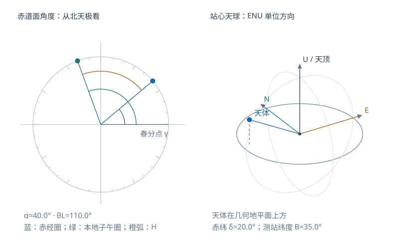

# 天球上的方向、赤经与时角

天球把天体的方向投影到一个假想球面，使观测任务转化为角度与时间的测量。理解“从哪一点看、沿哪一条轴量、角度朝哪边增加”，就能把星图、测站地平和坐标公式对应起来。本页对应 S6 文件页 21–31，先备知识是球面上的大圆、小圆与基本三角函数。

<!-- geodesy-interactive: celestial | 天球方向与测站水平坐标 | lab-celestial.svg -->

[离线打开交互图](../assets/interactive/celestial.html)

## 天球的中心决定观测方向

以测站观察者为中心得到站心天球，以地球中心为中心得到地心天球，半径可以任取。天球上的点表示方向，并不记录天体到中心的距离。相互平行且同向的射线可投影到同一点；这是 S6 第 22 页用来说明天球几何性质的关键。

中心发生平移时，有限距离目标的方向一般会变。月球和人造卫星的站心方向与地心方向之间要考虑视差；把中心从测站改成地心，需要目标距离或位置等信息。球面投影本身不会消去这种差别。

## 观察者的地平与地球自转轴

天顶 $Z$ 是当地铅垂线向上的方向，天底 $Z'$ 是相反方向。过观察者、垂直于铅垂线的平面为天文地平面，它与天球相交得到地平圈。铅垂方向由当地重力确定；椭球法线定义的是大地纬度，两者之间的偏差称垂线偏差。

地球自转轴方向在天球上给出北、南天极 $P,P'$，垂直于该轴的过心平面与天球相交得到天赤道。子午圈通过天顶、天底和两天极，与地平圈交于北点和南点；卯酉圈通过天顶、天底以及东、西点，其平面与子午圈平面垂直。先画出地平圈和子午圈，再标四方点，会比记忆图上的左右位置更可靠。

在近似球形地球的图中，测站纬度越高，北天极在地平上方越高。严格天文关系中，北天极的高度等于测站的天文纬度 $\phi$；$\phi$ 由铅垂线定义。本页算例忽略垂线偏差，采用这一几何关系。

## 赤经、赤纬与时角各量什么

赤纬 $\delta$ 是目标方向与天赤道面的夹角，向北为正，取值 $-90^\circ$ 到 $90^\circ$。过目标和两天极的大圆称时圈或赤经圈；同一赤纬上的轨迹一般为与赤道平行的小圆。

赤经 $\alpha$ 从春分点沿天赤道向东量到目标时圈，常用时分秒表示，$24^\mathrm h=360^\circ$，所以 $1^\mathrm h=15^\circ$。时角 $H$ 从当地子午圈沿赤道向西量到目标时圈。西侧目标通常取正时角，东侧目标可以取负时角；也可统一化到 $[0,24^\mathrm h)$。

以当地恒星时 $\theta$ 表示春分点的时角，同一套赤道、春分点和历元定义下有

$$
H=\theta-\alpha,\qquad \theta=H+\alpha\pmod{24^\mathrm h}.
$$

S6 第 27 页用 $t$ 表示时角，本专题用 $H$，把它与普通时间变量 $t$ 区分。式中 $H,\theta,\alpha$ 都是角度量，采用小时单位时应一致换算。

天球赤道直角坐标与方向的关系为

$$
\mathbf r=r\begin{bmatrix}
\cos\delta\cos\alpha\\
\cos\delta\sin\alpha\\
\sin\delta
\end{bmatrix}.
$$

若只研究方向，可令 $r=1$，得到单位方向向量；真实距离要由其他观测给出。完整坐标公式与反解见[参考系专题](geodesy-orbit-celestial-frames.md)。

## 中天与周日视运动

地球自西向东自转，让遥远天体表现为自东向西的周日视运动。目标通过测站子午圈的瞬间称中天；上中天对应 $H=0$，下中天对应 $H=12^\mathrm h$。上中天是一天中较高的一次子午圈通过，下中天是否在地平上方取决于测站纬度和天体赤纬。

作为球面几何补充，设目标高度角为 $a_{\rm alt}$，由天顶、北天极、目标组成的球面三角形可得

$$
\sin a_{\rm alt}=\sin\phi\sin\delta+
\cos\phi\cos\delta\cos H.
$$

在上中天 $H=0$ 时，利用 $\cos(\phi-\delta)=\sin\phi\sin\delta+\cos\phi\cos\delta$，得到

$$
a_{\rm upper}=90^\circ-|\phi-\delta|.
$$

这适用于忽略折射等观测改正的几何方向。测站在北半球时，北天区满足 $\delta>90^\circ-\phi$ 的目标为拱极星，全天几何上不落到地平以下。

## 黄道把周年视运动加入图中

黄道是地球绕太阳公转轨道平面在天球上的大圆，黄极为其法线方向。天赤道与黄道的夹角为黄赤交角，讲义示意约为 $23.5^\circ$；两圆交于春分点和秋分点。春分点是太阳沿周年视运动由南向北穿过天赤道的交点，用来定义本页的赤经零点。

太阳的视运动包括自转引起的周日运动和公转引起的周年运动。周年视运动沿黄道，使太阳赤纬在一年内变化；地轴倾斜与这一几何变化共同解释季节和昼长变化。S6 第 31 页的概括可在此理解为“具有黄赤交角的周年太阳运动”，公转远近变化并不是四季交替的主要原因。

## 完整算例：从恒星时判断星的位置

设北纬 $\phi=30^\circ$ 的测站，当地恒星时 $\theta=8^\mathrm h20^\mathrm m$，目标赤经 $\alpha=6^\mathrm h50^\mathrm m$，赤纬 $\delta=20^\circ$。全部角量采用同一历元、同一种平/真赤道定义。

时角为

$$
H=8^\mathrm h20^\mathrm m-6^\mathrm h50^\mathrm m
=1^\mathrm h30^\mathrm m=22.5^\circ.
$$

$H>0$ 表明目标位于当地子午圈以西，已过上中天。代入高度角公式：

$$
\sin a_{\rm alt}=\sin30^\circ\sin20^\circ+
\cos30^\circ\cos20^\circ\cos22.5^\circ
\approx0.92286,
$$

$$
a_{\rm alt}\approx67.35^\circ.
$$

它上中天时的几何高度为 $90^\circ-|30^\circ-20^\circ|=80^\circ$。这颗星的赤纬 $20^\circ$ 小于拱极条件的 $60^\circ$，因此会升落。算例把“时角决定是否过中天”和“纬度、赤纬决定日周轨迹”两件事分开计算。

## 自检

> [!info]- 1. 当地恒星时为5h，某星赤经为7h，它的时角是多少？
> $H=-2^\mathrm h$，或写成 $22^\mathrm h$。它在子午圈以东，尚未上中天。

> [!info]- 2. 天顶方向是否总是地心到测站的连线方向？
> 天顶由当地铅垂线给出，地心径向由地心到测站的连线给出。球对称重力模型中两者重合；真实地球和一般椭球条件下应区分。

> [!info]- 3. 在北纬40°，赤纬+60°的星是否拱极？
> 拱极阈值为 $90^\circ-40^\circ=50^\circ$。$60^\circ>50^\circ$，所以几何上不落；上中天高度为 $70^\circ$。

继续学习：[地球的几种运动](geodesy-orbit-earth-motion.md)。返回[辅助专题目录](geodesy-orbit-supplement.md)。
