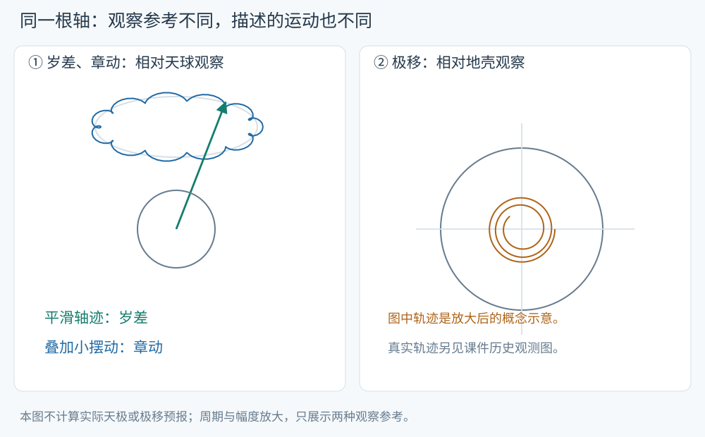
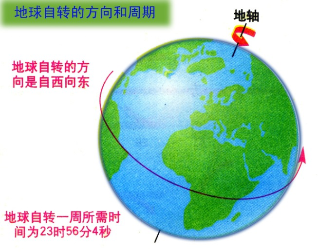
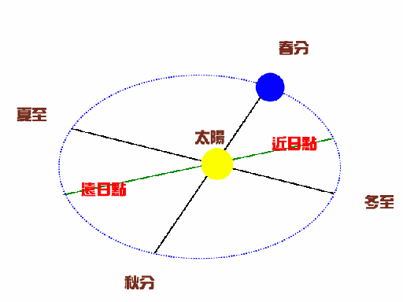
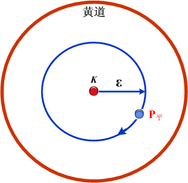
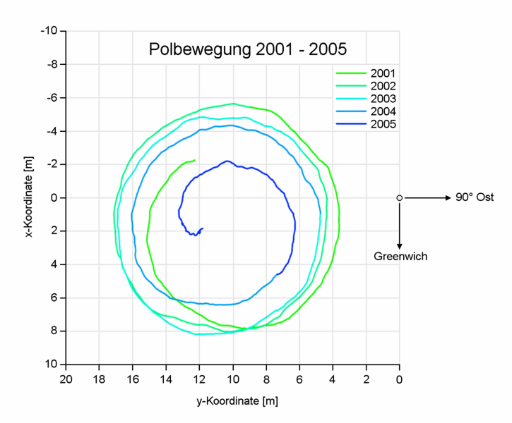

# 自转、公转、岁差、章动与极移

地球一边自转和公转，转轴相对天体背景的方向与相对地壳的位置也在变化。区分这些运动，最有效的方法是先指定观察参考：看天球上的轴向变化，还是看地球表面的极点变化。本页对应 S6 文件页 19、33–41，先读[天球的点与圈](geodesy-orbit-celestial-sphere.md)。

<!-- source-figure: {"src": "/geodesy/figures/earth-motion-reference.svg", "alt": "相对天球与相对地壳观察地轴", "source": "本站绘制", "page": "示意图", "original": true} -->

左图将长期轴迹与叠加摆动分开，右图把观察参考换成地壳。两图都放大幅度，只用于区分岁差、章动和极移的观察参考，不作为实际轴迹预报。本站绘制。
<!-- /source-figure -->

## 先分清自转与公转

地球自转是地球绕自身轴的转动，造成天体周日视运动。公转是地球绕太阳的轨道运动，造成太阳相对恒星背景的周年位置变化。S6 第 19 页并列展示这两种运动。

一恒星日约为 $23^\mathrm h56^\mathrm m4^\mathrm s$，一平太阳日按小时记为24小时。两者不同，是因为一天内地球沿公转轨道前进了一小段；为让太阳再次经过同一子午圈，地球还要多转约一度。这里的约数用于理解几何关系，太阳时与恒星时的严格定义见[时间系统](geodesy-orbit-time-systems.md)。

<!-- source-figure: {"src": "/geodesy/figures/source-earth-spin.png", "alt": "地球自转方向", "source": "S6 轨道力学基础", "page": "19", "locator": "幻灯片 19"} -->

来源：S6，幻灯片19的内嵌原图。自转使天体出现周日视运动；图中23时56分4秒是恒星日的近似长度，平太阳日为24小时。将自转一圈与太阳再次过同一子午圈区分开。
<!-- /source-figure -->

<!-- source-figure: {"src": "/geodesy/figures/source-earth-orbit.png", "alt": "地球公转与太阳周年位置", "source": "S6 轨道力学基础", "page": "19", "locator": "幻灯片 19"} -->

来源：S6，幻灯片19的内嵌原图。先识别太阳、近远日点和公转轨道，再对照正文的周年运动；轨道偏心与星体尺寸为示意比例。
<!-- /source-figure -->

## 太阳和月球为什么能改变轴的方向

赤道隆起使地球不是球对称刚体。太阳和月球对赤道隆起施加引力矩，使转动角动量的方向随时间变化，类似陀螺的进动。用最基本的角动量方程表示为

$$
\frac{d\mathbf L}{dt}=\boldsymbol\tau,
$$

$\mathbf L$ 是角动量，单位 $\mathrm{kg\,m^2\,s^{-1}}$；$\boldsymbol\tau$ 是力矩，单位 $\mathrm{N\,m}$。当力矩具有垂直于角动量的分量时，轴的指向发生转动。S6 第 34–35 页的日月作用和陀螺图用于说明这一点。

天球上缓慢、长期的轴向变化归入岁差，叠加其上的较短周期变化归入章动。精密理论还包括行星作用及黄道平面的长期变化；“北黄极固定”的示意图是便于观察轴迹的近似。

## 平天极、真天极与讲义的周期

S6 第 36–38 页用平天极表示去掉章动后的平滑轴向，用真天极表示加入章动后的轴向；对应地得到平/真赤道、平/真春分点。它们是随历元定义的几何对象，后面的坐标转换会逐项使用。

| 现象 | S6给出的教学近似 | 这些数值怎样使用 |
| --- | --- | --- |
| 岁差 | 周期约25800年，春分点每年西退约 $50.37''$ | 认识万年尺度的长期变化 |
| 章动 | 主要周期约18.6年，图中长半径约 $9.2''$ | 认识叠加在岁差上的周期摆动 |

这里的 $9.2''$ 描述天极轨迹示意中的角尺度，不能把它直接当作所有章动角分量的振幅。章动是多频率现象，18.6年主要与月球轨道交点运动有关；实际改正使用完整模型而非单一椭圆。岁差率也随定义、历元和模型变化。

<!-- source-figure: {"src": "/geodesy/figures/source-precession.png", "alt": "课件中的平天极岁差轨迹", "source": "S6 轨道力学基础", "page": "37", "locator": "幻灯片 37"} -->

来源：S6，幻灯片37的内嵌原图。K 为北黄极，蓝圈表示北黄极近似固定时的平天极轨迹，ε 为黄赤交角。圈上的运动对应相对天球的长期轴向变化，不能把它当作地表极点轨迹。
<!-- /source-figure -->

## 极移看的是地球表面

把观察参考换成随地壳转动的地球框架，地球极的位置随时间移动，这种现象称极移。S6 第 39–40 页给出极点轨迹和不同时段的观测曲线。轨迹图上的微小角度对应地表的米级位移，绘图会放大角尺度。

极移含年周期成分与约14个月的自由摆动，即钱德勒摆动。S6 第 41 页用“1年、$0.1''$”和“432天、$0.2''$”表示典型量级。真实地球的弹性、海洋及大气等共同影响周期和振幅；钱德勒自由模态会衰减，也会被质量运动和角动量交换重新激发。把“内部/外部因素”理解为讲义对自由与受迫成分的分类，有助于衔接真实地球的耦合行为。

岁差、章动与极移可以用同一根轴来想象，但它们分别记录该轴相对天球与相对地球的变化。现代定义补充：IERS使用天球中间极（CIP）及约定的频率划分组织天极运动和极移，CIP是精密转换中的约定中间极，不能在每个细节上等同于瞬时角速度轴。定义与转换关系见[IERS Conventions第5章](https://iers-conventions.obspm.fr/content/chapter5/icc5.pdf)。

<!-- source-figure: {"src": "/geodesy/figures/source-polar-motion-2001-2005.png", "alt": "2001–2005年的历史极移轨迹", "source": "S6 轨道力学基础", "page": "40", "locator": "幻灯片 40"} -->

来源：S6，幻灯片40的内嵌原图，保留原坐标轴和年份。图中两轴坐标单位为米，颜色区分2001–2005年；先看年际轨迹，再与正文角秒换米的量级比较。这是历史观测图。
<!-- /source-figure -->

## 完整算例：0.2角秒在地表有多远

取球形近似半径 $R=6371000\ \mathrm m$，给定极移角量级 $p=0.2''$。由于

$$
1''=\frac{\pi}{180\times3600}\ \mathrm{rad},
\qquad p\approx9.69627\times10^{-7}\ \mathrm{rad},
$$

极点附近相应弧长近似为

$$
s=Rp\approx6.1775\ \mathrm m.
$$

若年周期角振幅取 $0.1''$，则地表量级约为 $3.0887\ \mathrm m$。这里把一个角幅度换成球面弧长，用来认识轨迹的尺寸；某个测站坐标受到多大分量影响，还取决于测站位置和极移方向。

再按讲义 $50.37''/\mathrm{年}$ 的固定岁差率估算20年：

$$
\Delta\psi\approx20\times50.37''=1007.4''=0.279833^\circ.
$$

这个值表现的是参考方向累积变化的角量级。它不是任意恒星赤经或任意测站经度的共同改变量；完整坐标改正要通过旋转矩阵计算。

## 自检

> [!info]- 1. 一条图线表示地极在随地壳框架中的x、y坐标变化，它描绘哪种运动？
> 极移。若图线是在天球上围绕黄极附近绘制长期轴向轨迹，才是在展示岁差和章动。

> [!info]- 2. 为什么不能用18.6年一个正弦函数代替所有章动？
> 18.6年是主要周期之一。日月引力和地球响应产生多种周期项，完整模型还分别描述不同角分量及其相位。

> [!info]- 3. 若极移角量级为0.3角秒，用上述半径估算地表弧长。
> $s=6371000\times0.3\pi/(180\times3600)\approx9.2662\ \mathrm m$。

继续学习：[时间系统与时刻换算](geodesy-orbit-time-systems.md)。返回[辅助专题目录](geodesy-orbit-supplement.md)。
