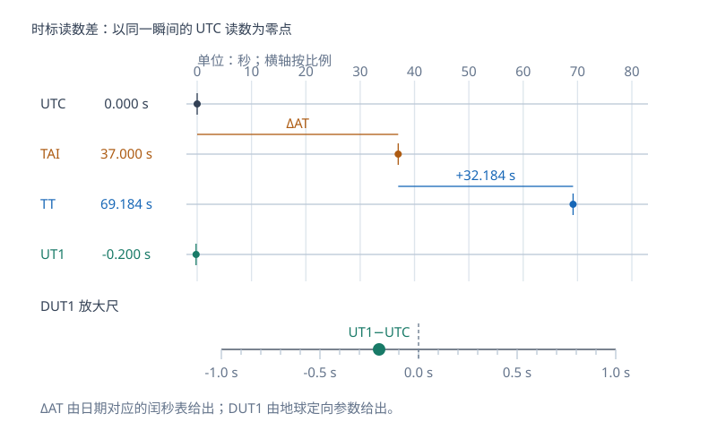

# 时间系统：恒星时、太阳时、UT1、TAI、UTC与TT

“12:00:00”必须与日期、时间尺度共同出现，才能确定一个可用于坐标和运动计算的时刻。地球转角用UT1联系，均匀计时由原子时提供，天体与参考系模型常采用TT；它们各自服务不同计算任务。本页对应 S6 文件页 43–62，先读[天球与时角](geodesy-orbit-celestial-sphere.md)。

<!-- geodesy-interactive: time | 同一瞬间的UTC、TAI与TT读数 | lab-time.svg -->

各行是同一瞬间的不同时间标签；先看输入的闰秒差和 DUT1，再读 TAI、TT、UT1 相对 UTC 的差值。本站绘制。

[离线打开交互图](../assets/interactive/time.html)

## 时刻、间隔与秒长

时刻是某一事件在时间尺度上的标记，时间间隔是两事件之间的持续量。S6 第 43 页用“起始历元+秒长”说明计时约定：既要规定起点，也要规定计量单位与尺度的推进方式。时刻相减时，先统一时间尺度；跨越闰秒的UTC标签尤其需要按相应日期的规则解释。

S6 第 44 页以地球自转、地球公转与原子能级跃迁概括计时的物理基础。历史上的历书时从天体运动理论建立较均匀的时间自变量，原子时则借助稳定的原子频率实现秒长。它们共同说明“观测地球转了多少”和“计量经过多少秒”可以由不同系统承担。

## 恒星时是一个转角

当地恒星时等于春分点的当地时角，春分点上中天时恒星时为零。恒星日是春分点连续两次上中天的间隔，分成24恒星时。采用一致的赤道与春分点定义，有

$$
\theta_{\rm local}=H+\alpha.
$$

$\alpha$ 为目标赤经，$H$ 为向西量取的时角。S6 第 48–49 页说明可以利用已知赤经的恒星观测得到恒星时。平春分点给出平恒星时，真春分点给出真恒星时；目标赤经也要采用相应的平/真位置。

恒星时随测站经度改变。若天文经度 $\lambda$ 向东为正，格林尼治恒星时为 $\theta_G$，则

$$
\theta_{\rm local}=\theta_G+\frac{\lambda}{15^\circ/\mathrm h}
\pmod{24^\mathrm h}.
$$

它表示当地子午圈相对天球的方向，不是普通民用时钟中的“标准时间”。

## 真太阳时、平太阳时与世界时

真太阳日是太阳中心连续两次上中天的间隔。真太阳时以平子夜的类似约定计时，太阳上中天对应约12时，表达为太阳时角加12小时。日长变化有两个几何来源：地球公转速度变化，以及黄道到赤道的投影受黄赤交角影响。

平太阳是假想的均匀参考点：它沿天赤道均匀运动，一个回归年运行一周。用它的时角加12小时定义平太阳时，消除了上述周年性不均匀。天文观测可先测恒星时，再按理论转换为平太阳时，这就是讲义所说的测时。若用时差（equation of time），应先声明符号，例如 $E=\text{真太阳时}-\text{平太阳时}$，再做加减。

世界时 UT 源于格林尼治地方平太阳时。S6 第 54 页的 $m-M=\lambda$ 把经度按时间单位表示；若经度用度，关系应写成

$$
\mathrm{地方平太阳时}=\mathrm{UT}+
\frac{\lambda}{15^\circ/\mathrm h}.
$$

东经为正，所以同一瞬间东边的地方平太阳时更晚。时区标准时间按法定时区规定；北京时间采用 UTC+8小时，与各测站自身的地方平太阳时概念不同。

| 名称 | S6的教学关系 | 物理含义 |
| --- | --- | --- |
| UT0 | 原始天文测时结果 | 会受观测站极移效应影响 |
| UT1 | UT0加极移改正 | 用来表达地球自转状态 |
| UT2 | UT1加季节性自转改正 | 历史上进一步平滑季节变化的尺度 |

现代定义补充：UT1由地球自转角ERA通过约定的线性关系定义，精密应用采用发布的地球定向参数。UT2是学习历史计时体系时的概念；UT1负责现代地球定向转换中的转角部分。关系见[IERS Conventions第5章](https://iers-conventions.obspm.fr/content/chapter5/icc5.pdf)。

## 原子秒和国际原子时

SI秒通过铯-133原子不受扰动基态超精细跃迁频率的固定值定义：

$$
\Delta\nu_{\rm Cs}=9\,192\,631\,770\ \mathrm{Hz}.
$$

因此一秒对应这段辐射的9,192,631,770个周期。S6 第 57 页用“海平面、零磁场”介绍原子秒背景。现代定义补充：SI正式定义强调不受扰动的原子跃迁，实验钟频还需环境与相对论频移等改正，海平面不是原子跃迁定义的必要地点条件。原文见[BIPM：秒的定义](https://www.bipm.org/en/si-base-units/second)。

国际原子时 TAI（Temps atomique international）由各地原子钟数据比对和统计处理形成统一连续尺度，由BIPM计算。S6 第 58 页的“约100台”属于讲义时期的描述，理解重点是多钟联合实现，而非把这个台数作为固定定义。BIPM的[时间计量说明](https://www.bipm.org/en/time-metrology)提供尺度实现与发布信息。

S6 第 57 页还列出1958年1月1日与UT2的历史起算背景，并给出 $\mathrm{TA}=\mathrm{UT2}-0.0039\ \mathrm s$ 的旧实现说明。这是历史对齐信息，现代任意日期的TAI与UT1差值要取对应历元的数据，不能套用这一常数。

## UTC把原子计时与地球自转联系起来

协调世界时 UTC 的英文为 Coordinated Universal Time，S6 第 59 页的 Coordinate 属于用词差异。UTC采用原子秒，在1972年建立的制度中通过整秒调整使其与UT1保持接近；早期UTC还使用过频率调整和小幅步进。具体制度及调整须按目标日期的官方公告解释。

对已给定的适用时段，令

$$
\Delta_{\rm AT}=\mathrm{TAI}-\mathrm{UTC},
\qquad \mathrm{DUT1}=\mathrm{UT1}-\mathrm{UTC}.
$$

$\Delta_{\rm AT}$ 在采用整秒制度的区间内为整数秒；DUT1反映地球自转与UTC的差。它们是不同量。实际处理数据时，应查目标日期对应的时间差和地球定向参数，本页例题直接给定数值。

## TT、TDT与TDB分别服务什么任务

S6 第 61 页把用于天体理论和历表计算的时间放在“力学时”中介绍。地球时 TT（Terrestrial Time）是地心理论常用的时间尺度，TDT是其历史名称。采用TAI实现时，精确关系为

$$
\mathrm{TT(TAI)}=\mathrm{TAI}+32.184\ \mathrm s.
$$

TT本身有理论定义，TT(TAI)是通过TAI实现的版本。由此有

$$
\Delta T=\mathrm{TT}-\mathrm{UT1}
=32.184\ \mathrm s+\Delta_{\rm AT}-\mathrm{DUT1}.
$$

这里用TT(TAI)计算时忽略其相对理论TT的实现误差，足以完成本页教学换算。S6 的1977年起算说明与时间尺度历史定义有关，不表示TT只能标记1977年之后的事件。

太阳系质心动力学时 TDB（Barycentric Dynamical Time）用于太阳系质心相关的动力学计算。现代定义补充：TT与地心坐标时TCG有固定比例关系，TDB与质心坐标时TCB有约定线性关系；TDB与TT之间的差则随地球运动和位置等变化。因此不把TDB简单写成“TAI再加一个普适常数”。相关定义汇总在[IERS第5章第5.3.1节](https://iers-conventions.obspm.fr/content/chapter5/icc5.pdf)。

## 年、月也要指定参照对象

S6 第 62 页列出若干年、月名称，可以按“相对什么重复一周”理解。

| 周期名称 | 参照对象或约定 |
| --- | --- |
| 恒星年 | 地球公转相对恒星背景的一周 |
| 回归年 | 平太阳黄经相对移动的春分点增加 $360^\circ$ 的周期 |
| 儒略年 | 约定为365.25日，每日86400 SI秒，共31557600秒 |
| 格里历年 | 历法年通常365日、闰年366日；400年平均365.2425日 |
| 恒星月 | 月球相对恒星背景的一周 |
| 回归月 | 月球平黄经相对春分点增加 $360^\circ$ 的周期 |
| 朔望月 | 月球相对太阳的平均相位循环，例如新月到下一新月 |

朔望月与恒星月不同，是因为月球绕地球运行期间，太阳的天球方向也在变化。历法中每个月的日数又是另一层日历约定。

## 完整算例一：UTC转换到TAI、TT和UT1

给定一个教学日期D的UTC时刻为23:59:20.000，并明确假设该附近区间没有时间调整，$\Delta_{\rm AT}=37\ \mathrm s$、$\mathrm{DUT1}=+0.200\ \mathrm s$。这两个值是题设，不表示任何未指定日期的现行时间差。

$$
\mathrm{TAI}=D\ 23{:}59{:}57.000,
$$

$$
\mathrm{TT(TAI)}=(D+1)\ 00{:}00{:}29.184,
\qquad
\mathrm{UT1}=D\ 23{:}59{:}20.200.
$$

TT跨到了次日，不能只加秒而遗漏日期进位。两尺度差为

$$
\Delta T=32.184+37-0.200=68.984\ \mathrm s.
$$

## 完整算例二：地方时与恒星时

若同一瞬间UT1约为03:00:00，测站天文经度取 $121.5^\circ\mathrm E$，则讲义平太阳时关系给出

$$
121.5^\circ/15=8.1^\mathrm h=8^\mathrm h06^\mathrm m,
\qquad \text{地方平太阳时}\approx11{:}06{:}00.
$$

若格林尼治恒星时另给定为 $10^\mathrm h20^\mathrm m$，当地恒星时为 $18^\mathrm h26^\mathrm m$。对赤经 $17^\mathrm h56^\mathrm m$ 的目标，$H=30^\mathrm m=7.5^\circ$，目标已在子午圈西侧。UT1数值本身不能直接替代恒星时，二者之间要通过给定日期的转角关系计算。

## 自检

> [!info]- 1. ΔAT=36s、DUT1=-0.4s时，ΔT是多少？
> $\Delta T=32.184+36-(-0.4)=68.584\ \mathrm s$。DUT1定义为UT1减UTC，代入时要保留它的符号。

> [!info]- 2. 经度向东增加30°，同一瞬间的地方恒星时变化多少？
> 增加 $30^\circ/15^\circ=2^\mathrm h$，超过24小时需取模。地方平太阳时的经度差换算也具有这一角度关系。

> [!info]- 3. 同一UTC标签，缺少日期是否可以唯一转换成TT？
> 需要日期。TAI与UTC的差取决于适用时期；完整事件时刻还要有日期本身。给定目标日期的差值后，再用32.184秒完成TT(TAI)转换。

继续学习：[参考系与旋转链](geodesy-orbit-celestial-frames.md)。返回[辅助专题目录](geodesy-orbit-supplement.md)。
