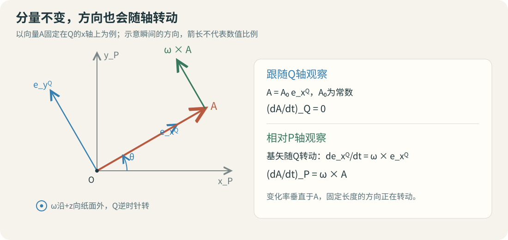

# 旋转坐标系中的矢量导数与速度转换

固定在地球上的测站，其地固坐标可以近似不变，但相对天球却有自转速度。两种描述通过“基矢本身在转动”联系起来。本页逐步展开 S6 文件页 71–73 的矢量导数公式，先读[方向余弦阵与旋转](geodesy-orbit-celestial-frames.md)，并掌握乘积求导与叉积。

## 分量不变，向量方向仍可改变

图中让 $\mathbf A$ 固定在 $Q$ 的一根轴上，单独观察轴转动产生的导数；下面把这一特例推广到分量也变化的一般情况。图为依据S6第71–73页公式绘制的教学示意。

取两组共同原点的坐标轴 $P,Q$，$Q$ 相对 $P$ 以角速度 $\boldsymbol\omega_{Q/P}$ 转动。把空间向量写成

$$
\mathbf A=A_x\mathbf e_x^Q+A_y\mathbf e_y^Q+A_z\mathbf e_z^Q.
$$

这里 $A_x,A_y,A_z$ 是标量分量，$\mathbf e_i^Q$ 是 $Q$ 系单位基矢。观察者跟随 $Q$ 轴时只看到分量的变化；用 $P$ 轴观察时，还会看到 $Q$ 轴自身的转动。

在 $P$ 系中对上式逐项求导：

$$
\left(\frac{d\mathbf A}{dt}\right)_P
=\sum_i\dot A_i\mathbf e_i^Q+
\sum_iA_i\left(\frac{d\mathbf e_i^Q}{dt}\right)_P.
$$

第一项定义为 $Q$ 系观察到的矢量导数

$$
\left(\frac{d\mathbf A}{dt}\right)_Q=\sum_i\dot A_i\mathbf e_i^Q.
$$

S6 第 72 页用 $\delta\mathbf A/\delta t$ 表示这一相对导数。它依然是空间向量，只是在求导时固定 $Q$ 的基矢。

## 泊松公式把基矢变化变成叉积

转动向量在微小时间 $dt$ 内的变化为 $d\mathbf e_i=\boldsymbol\omega_{Q/P}\times\mathbf e_i\,dt$，因此

$$
\left(\frac{d\mathbf e_i^Q}{dt}\right)_P
=\boldsymbol\omega_{Q/P}\times\mathbf e_i^Q.
$$

把它代回乘积求导式，利用叉积对加法和数乘的分配律得到

$$
\boxed{\left(\frac{d\mathbf A}{dt}\right)_P
=\left(\frac{d\mathbf A}{dt}\right)_Q
+\boldsymbol\omega_{Q/P}\times\mathbf A.}
$$

这就是旋转参考系的运输定理。$\boldsymbol\omega\times\mathbf A$ 描述轴的转动贡献；叉积顺序固定，交换成 $\mathbf A\times\boldsymbol\omega$ 会改变符号。角速度以 $\mathrm{rad\,s^{-1}}$ 表示，若 $\mathbf A$ 是米，则导数单位为米每秒。

S6 第 73 页称两项为绝对导数和相对导数，并强调它们的关系与惯性/非惯性的标签无关。这里的 $P$ 可以是任意参考系；当特意取 $P$ 为惯性系时，才把左边解释为相对惯性系的变化率。角速度始终指 $Q$ 相对 $P$ 的转动。

## 写成分量时还要统一坐标系

若 $\mathbf A^P=C^P_Q\mathbf A^Q$，直接求导可得

$$
\dot{\mathbf A}^{P}=C^P_Q\dot{\mathbf A}^{Q}
+\dot C^P_Q\mathbf A^Q.
$$

设 $[\boldsymbol\omega^P]_\times$ 为叉积矩阵，满足 $[\boldsymbol\omega^P]_\times\mathbf v^P=\boldsymbol\omega^P\times\mathbf v^P$，则

$$
\dot C^P_Q=[\boldsymbol\omega_{Q/P}^P]_\times C^P_Q,
\quad
\dot{\mathbf A}^{P}=C^P_Q\dot{\mathbf A}^{Q}
+\boldsymbol\omega_{Q/P}^P\times\mathbf A^P.
$$

例如 $\boldsymbol\omega^P=(0,0,\omega)^T$ 时，

$$
[\boldsymbol\omega^P]_\times=
\begin{bmatrix}0&-\omega&0\\\omega&0&0\\0&0&0\end{bmatrix}.
$$

公式右侧的所有分量都转换到 $P$ 系再相加。仅把 $Q$ 系的导数列与 $P$ 系的叉积列直接相加，数值上没有共同的轴作为依据。

## 位置转换到速度转换

对共同原点的位置向量 $\mathbf r$ 应用同一公式：

$$
\mathbf v_P=\mathbf v_Q+
\boldsymbol\omega_{Q/P}\times\mathbf r.
$$

这里先把两边理解为空间向量。若 $Q$ 是地固系、$P$ 是近似不转动的地心天球系，固定测站有 $\mathbf v_Q\approx0$，所以天球系速度来自 $\boldsymbol\omega\times\mathbf r$。若两个原点还发生相对平移，点速度转换需另加原点平移速度。

作为推导补充，再求一次导数可得到共同原点下的加速度关系：

$$
\mathbf a_P=\mathbf a_Q+2\boldsymbol\omega\times\mathbf v_Q
+\dot{\boldsymbol\omega}_P\times\mathbf r
+\boldsymbol\omega\times(\boldsymbol\omega\times\mathbf r).
$$

各项依次为相对加速度、科里奥利项、角速度变化项和转动的向心项。这是把同一运输定理连续应用两次的结果，用于连接坐标运动学与动力学；S6第71–73页的直接教学重点为一阶导数。

## 完整算例：固定在赤道的测站为什么有速度

取教学半径 $R=6378137\ \mathrm m$，角速度 $\omega=7.292115\times10^{-5}\ \mathrm{rad\,s^{-1}}$。某一瞬间，测站在 $P$ 系中的位置为 $(R,0,0)^T$，$\boldsymbol\omega=(0,0,\omega)^T$，且固定在 $Q$ 系。

由于 $\mathbf v_Q=0$，

$$
\mathbf v_P=(0,0,\omega)^T\times(R,0,0)^T
=(0,\omega R,0)^T
\approx(0,465.1011,0)^T\ \mathrm{m\,s^{-1}}.
$$

叉积指向 $+y$，与绕 $+z$ 轴按右手规则转动相符。在恒定角速度近似中，再求导：

$$
\mathbf a_P=\boldsymbol\omega\times(\boldsymbol\omega\times\mathbf r)
=(-\omega^2R,0,0)^T
\approx(-0.0339157,0,0)^T\ \mathrm{m\,s^{-2}}.
$$

这表示测站随地球旋转轨迹的向心加速度。计算实际受力时，要结合重力和支持力等动力学条件；这里求得的是指定转动下的运动学加速度。

若测站在球形模型的纬度 $45^\circ$，其到转轴的距离是 $R\cos45^\circ$，速度大小为 $\omega R\cos45^\circ\approx328.8761\ \mathrm{m\,s^{-1}}$。决定自转线速度的是到轴的距离，而非单独的地心距离。

## 自检

> [!info]- 1. Q系中的Ax、Ay、Az都不变，P系中的导数一定为零吗？
> 导数为 $\boldsymbol\omega_{Q/P}\times\mathbf A$。向量沿转轴或角速度为零时该项才为零；一般情况下，分量不变仍有轴转动贡献。

> [!info]- 2. 给定ω=(0,0,2) rad/s、A=(3,0,0) m，A在Q系固定，P系导数是多少？
> 在同一坐标系中求叉积得到 $(0,6,0)\ \mathrm{m\,s^{-1}}$。

> [!info]- 3. 为什么位置能用C乘过去，速度却通常还多一项？
> 因为 $C$ 随时间变化。$d(C\mathbf r)/dt=C\dot{\mathbf r}+\dot C\mathbf r$，后一项记录参考轴转动带来的变化。

返回[辅助专题目录](geodesy-orbit-supplement.md)，或回看[参考系与完整旋转链](geodesy-orbit-celestial-frames.md)。
