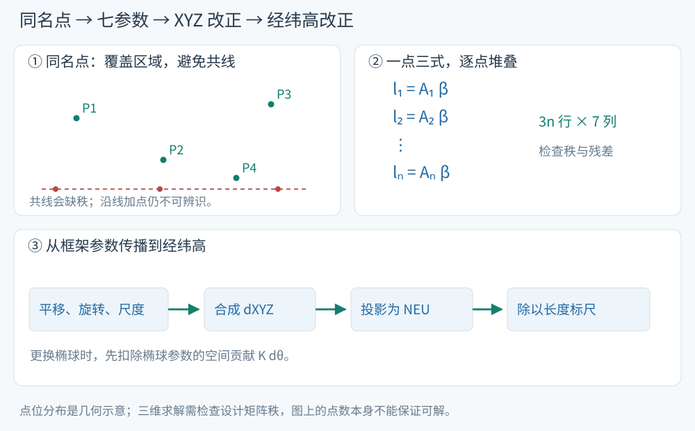

# 从同名点估计七参数，再传播到大地坐标

已知七参数时，转换一个点只需代入；参数未知时，要用若干个同名点的两套坐标共同估计。求得的参数再通过第五章的雅可比传播到经纬高。本页对应 S11 第23、29、31–33页，其中最小二乘的求解与数值检核为教学展开。

<!-- source-figure: {"src": "/geodesy/figures/parameter-estimation-flow.svg", "alt": "同名点几何、参数方程与大地坐标传播", "source": "本站绘制", "page": "示意图", "original": true} -->

左上先观察同名点是否覆盖区域，再看右上每个点如何贡献三条方程；下方先投影为北、东、上（NEU），再分别换成 dB、dL、dh。严格共线会缺秩，近共线则可能产生弱约束；点数足够后仍需检查三维几何和矩阵秩。本站绘制。
<!-- /source-figure -->

## 一点三条方程，组成七列设计矩阵

对第 i 个同名点，记已知坐标差为 $\mathbf l_i=\mathbf r_{t,i}-\mathbf r_{s,i}$，未知参数按

$$
\boldsymbol\beta=(t_x,t_y,t_z,\varepsilon_x,\varepsilon_y,\varepsilon_z,\mu)^T
$$

排列。一阶模型给出 $\mathbf l_i\approx A_i\boldsymbol\beta$，其中

$$
\boxed{A_i=\begin{pmatrix}
1&0&0&0&-Z_i&Y_i&X_i\\
0&1&0&Z_i&0&-X_i&Y_i\\
0&0&1&-Y_i&X_i&0&Z_i
\end{pmatrix}.}
$$

将所有点逐行堆叠成 $\mathbf l,A$。三个平移系数为单位阵，旋转系数为位置向量的叉乘矩阵，尺度系数为位置向量本身。参考点模型则把旋转、尺度列中的坐标换成相对参考点的坐标差，平移列保持单位阵。

一般需要至少3个不共线的三维同名点，并检查 $\operatorname{rank}A=7$。点数多于最低要求时，可通过冗余观测检验拟合质量。若所有点共线，绕该直线的旋转与平移组合会出现不可分辨的自由度；只靠增加同一直线上的点数无法消除它。

## 最小二乘怎样使用观测精度

令残差 $\mathbf v=A\widehat{\boldsymbol\beta}-\mathbf l$，权阵 P 表示坐标差的相对精度。加权最小二乘使

$$
\boxed{\mathbf v^TP\mathbf v\to\min.}
$$

理论正规方程为

$$
A^TPA\,\widehat{\boldsymbol\beta}=A^TP\mathbf l.
$$

实际计算用加权 QR 或 SVD 求解线性最小二乘，减少显式形成正规矩阵对条件数的放大。权阵来自坐标差的协方差；源、目标坐标均有误差时，应依据精度关系传播协方差，必要时采用两套坐标共同含误差的模型。

> [!info]- 单位缩放、参数协方差与独立检核
> 若未知参数以 m、角秒、ppm 混合记录，令
>
> $$
> S=\operatorname{diag}(1,1,1,\rho,\rho,\rho,10^{-6}),\qquad
> \rho=\pi/648000.
> $$
>
> 将 $\boldsymbol\beta=S\boldsymbol\gamma$ 代回得到 $AS\boldsymbol\gamma=\mathbf l$，$\boldsymbol\gamma$ 的数值就按“米、角秒、ppm”求解。这样既与参数表单位一致，也有利于平衡矩阵各列量级。检查条件数应说明列的缩放方式。
>
> 当 P 是相对权阵且观测模型成立时，自由度 $f_r=3n-7$，单位权方差估计为
>
> $$
> \widehat\sigma_0^2=\frac{\mathbf v^TP\mathbf v}{3n-7},\qquad
> \operatorname{Cov}(\widehat{\boldsymbol\beta})
> =\widehat\sigma_0^2(A^TPA)^{-1}.
> $$
>
> 若输入的是已知绝对协方差的逆，则参数协方差直接为 $(A^TPA)^{-1}$，无需再机械乘上经验方差。未知点的转换精度还应传播输入点坐标的不确定度。
>
> 残差用于检查拟合；空间上独立的检核点用于评价转换在其他位置的表现。区域同名点的几何分布会决定参数相关性与外推稳定性，公共点宜覆盖实际应用区域。

## 算例：四个点恢复七个教学参数

构造源点 $(0,0,0)$、$(1000,0,0)$、$(0,1000,0)$、$(0,0,1000)$ m；这是为清楚展示列系数而取的教学几何。用参数 $\mathbf t=(1,-2,3)$ m、$\boldsymbol\varepsilon=(0.1'',-0.2'',0.3'')$、$\mu=2$ ppm 生成一阶观测差：

| 源点 XYZ（m） | ΔX（m） | ΔY（m） | ΔZ（m） |
|---|---:|---:|---:|
| (0,0,0) | 1.00000000 | −2.00000000 | 3.00000000 |
| (1000,0,0) | 1.00200000 | −2.00145444 | 2.99903037 |
| (0,1000,0) | 1.00145444 | −1.99800000 | 2.99951519 |
| (0,0,1000) | 1.00096963 | −1.99951519 | 3.00200000 |

组装12×7矩阵，采用上述单位缩放，以未舍入观测和等权 SVD 求解，得到秩7，恢复

$$
\boxed{\widehat{\boldsymbol\gamma}=(1,-2,3,0.1,-0.2,0.3,2)^T,}
$$

最大绝对残差约 $2.3\times10^{-15}$ m。这验证了参数列、符号和单位的实现；使用上表的八位小数重算会产生相应的舍入残差。合成无噪声例子的零残差用于公式检核，真实控制点还要用其精度、残差与独立检核点评价转换质量。

## 参数变化如何传到 BLH

S11 第31–32页将框架变化和椭球参数变化合并。记 $q=e^2$，$\mathbf g=(B,L,h)^T$，第五章已有

$$
d\mathbf g=D^{-1}Q_{NEU}^T
\left[d\mathbf r-K\begin{pmatrix}da\\dq\end{pmatrix}\right].
$$

一阶框架转换产生的坐标变化为

$$
d\mathbf r=\mathbf t+C(\mathbf r)\boldsymbol\varepsilon+\mu\mathbf r.
$$

所以

$$
\boxed{d\mathbf g=D^{-1}Q_{NEU}^T
\left[\mathbf t+C(\mathbf r)\boldsymbol\varepsilon+\mu\mathbf r
-K\begin{pmatrix}da\\dq\end{pmatrix}\right].}
$$

这就是课件的大地坐标微分公式：先合成空间位置差并扣除参考椭球参数贡献，再投影到局部方向，最后除以角度标尺。$K$ 和 $D$ 见[椭球参数变化](geodesy-ellipsoid-parameter-change.md)及[坐标微分](geodesy-coordinate-differentials.md)。

> [!info]- 逐分量形式与计算顺序
> 先求 $\mathbf u=\mathbf t+C(\mathbf r)\boldsymbol\varepsilon+\mu\mathbf r$，记 $u_N=\mathbf e_N^T\mathbf u$、$u_E=\mathbf e_E^T\mathbf u$、$u_U=\mathbf e_U^T\mathbf u$，则
>
> $$
> \begin{aligned}
> dB={}&\frac{u_N}{M+h}
> +\frac{q\sin B\cos B}{W(M+h)}da
> +\frac{N\sin B\cos B(2-q\sin^2B)}{2W^2(M+h)}dq,\\
> dL={}&\frac{u_E}{(N+h)\cos B},\\
> dh={}&u_U-Wda+\frac{N\sin^2B}{2}dq.
> \end{aligned}
> $$
>
> 若源、目标使用同一个椭球，令 da=dq=0；若原点与轴向不变而只换椭球，令 $\mathbf u=0$。所有系数均在源点及源椭球参数处计算，结果为一阶增量。
>
> 对于较大变化或更高精度任务，完整计算路线为：源 BLH 正算为源 XYZ → 精确框架变换 → 按目标椭球反算目标 BLH。微分公式可用于敏感性解释、小改正及结果检核。

## 算例：七参数带来的经纬高变化

用第五章例点和上面的教学七参数，保持椭球相同。先前求得 $d\mathbf r=(5.265371852,13.028979912,10.132298120)^T$ m，代入逆雅可比：

$$
\boxed{dB\approx0.13901201'',\quad dL\approx-0.42811359'',\quad dh\approx12.41306936\ \mathrm m.}
$$

把 $\mathbf r+d\mathbf r$ 完整反算，再与原 BLH 相减，可得约 $\Delta B=0.13901154''$、$\Delta L=-0.42811293''$、$\Delta h=12.41308081$ m。差异为坐标参数化中的二阶效应；两种路线使用的是同一组一阶框架坐标差。

## 自检

1. 一组同名点数量足够，是否就一定能稳定求得七参数？
2. 设计矩阵的旋转列为什么含 XYZ，而平移列是0或1？
3. 把 dXYZ 直接当成 dBLH，会混淆哪些量？

> [!info]- 展开答案
> 1. 还要检查矩阵秩、点位分布、观测精度和参数相关性。共线或范围过窄的几何会造成不可解或较弱约束。
> 2. 平移对每个点产生相同的轴向增量；旋转引起的位移与点到旋转中心的杠杆向量有关，因此系数包含坐标。
> 3. XYZ 是沿全球直角轴的长度；B、L 是角，h 是沿椭球法线的长度。需要投影并除以相应曲率标尺；更换椭球时还须加入参数项。

返回[第六章](geodesy-frame-transformations.md) · 回读[第五章](geodesy-coordinate-conversion.md)。
