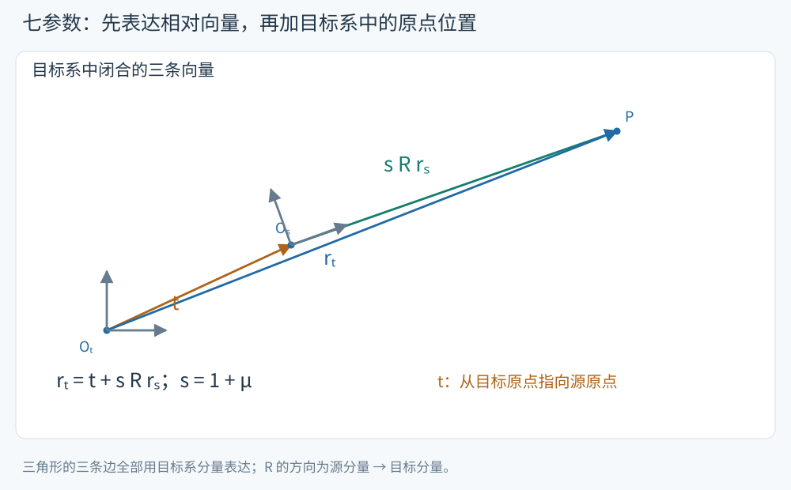

# Bursa–Wolf：平移、旋转与尺度的七参数模型

两个空间框架可能具有不同原点、不同轴向和不同长度尺度。Bursa–Wolf 模型用3个平移、3个旋转和1个尺度，把同一点的两套坐标连接起来。本页对应 S11 第22–24页，采用与课件一致的被动旋转符号。

<!-- source-figure: {"src": "/geodesy/figures/seven-parameter-vectors.svg", "alt": "七参数转换的原点与相对向量", "source": "本站绘制", "page": "示意图", "original": true} -->

橙色 t 从目标原点指向源原点；绿色边已旋转、缩放到目标系表达，与 t 相加才得到蓝色目标位置向量。三条边用同一目标基底闭合，不能直接把不同基底下的分量相加。本站绘制。
<!-- /source-figure -->

## 先写清输入与输出

以 $\mathbf r_s=(X_s,Y_s,Z_s)^T$ 表示源系坐标，$\mathbf r_t$ 表示目标系坐标：

$$
\boxed{\mathbf r_t=\mathbf t+(1+\mu)R\mathbf r_s.}
$$

$\mathbf t=(t_x,t_y,t_z)^T$ 的单位是米，表示源系数值原点在目标坐标表达中的位置；$\mu$ 是无量纲相对尺度差，R 是从源分量到目标分量的旋转矩阵。正式参数必须附带源框架、目标框架、参考历元与旋转约定。

旋转有两种常见符号约定：本页与 S11 的小角阵为 $I-[\boldsymbol\varepsilon]_\times$；若另一资料使用 $I+[\boldsymbol\varepsilon]_\times$，其旋转数值的符号相反。两者在参数元数据明确时表达同一个变换。

## 从精确式到一阶式

先以小角代替 R，保留尺度与旋转的乘积：

$$
\mathbf r_t\approx\mathbf t+(1+\mu)(I-[\boldsymbol\varepsilon]_\times)\mathbf r_s.
$$

再略去 $\mu\varepsilon$，得到 S11 第23页的线性模型

$$
\boxed{\mathbf r_t-\mathbf r_s=\mathbf t+C(\mathbf r_s)\boldsymbol\varepsilon+\mu\mathbf r_s,}
$$

其中

$$
C(\mathbf r_s)=[\mathbf r_s]_\times
=\begin{pmatrix}0&-Z_s&Y_s\\Z_s&0&-X_s\\-Y_s&X_s&0\end{pmatrix}.
$$

因为 $-[\boldsymbol\varepsilon]_\times\mathbf r_s
=\mathbf r_s\times\boldsymbol\varepsilon$，课件的参数系数矩阵自然出现这个符号。逐分量为

$$
\begin{aligned}
\Delta X&=t_x-Z_s\varepsilon_y+Y_s\varepsilon_z+\mu X_s,\\
\Delta Y&=t_y+Z_s\varepsilon_x-X_s\varepsilon_z+\mu Y_s,\\
\Delta Z&=t_z-Y_s\varepsilon_x+X_s\varepsilon_y+\mu Z_s.
\end{aligned}
$$

用弧秒存放的旋转先乘 $\pi/648000$；用 ppm 存放的尺度先乘 $10^{-6}$。例如1 ppm 在6000 km的地心距离上对应约6 m，1″旋转对应约29 m的横向变化。

> [!info]- 反向转换与误差项的阶次
> 当 $R^TR=I$ 且 $1+\mu\ne0$ 时，完整相似变换的逆为
>
> $$
> \boxed{\mathbf r_s=\frac1{1+\mu}R^T(\mathbf r_t-\mathbf t).}
> $$
>
> 若要写成 $\mathbf r_s=\mathbf t_{\rm inv}+s_{\rm inv}R_{\rm inv}\mathbf r_t$，应取
>
> $$
> s_{\rm inv}=(1+\mu)^{-1},\quad
> R_{\rm inv}=R^T,\quad
> \mathbf t_{\rm inv}=-s_{\rm inv}R^T\mathbf t.
> $$
>
> 若实际使用的是截断阵 $I-[\boldsymbol\varepsilon]_\times$，它并不严格正交，转置只给出相应的一阶逆。完整计算可使用精确旋转，或对实际线性矩阵求逆。
>
> 将三个参数组分别变号，还隐含舍去 $\mu\mathbf t$、$[\boldsymbol\varepsilon]_\times\mathbf t$ 等交叉项。例如被动绕 z 转 $1''$、$\mathbf t=(1000,0,0)^T$ m、$\mu=0$，精确逆平移约为 $(-1000,-0.004848,0)^T$ m，直接取 $-\mathbf t$ 会漏掉约4.848 mm。完整转换使用上面的逆式。
>
> 小角近似舍去的坐标项约为 $O(\|\mathbf r\|\|\boldsymbol\varepsilon\|^2)$；线性化又舍去 $O(\|\mathbf r\||\mu|\|\boldsymbol\varepsilon\|)$。采用精确 R 时仍需明确旋转轴与顺序；七参数只是参数数量，并未自动确定欧拉角约定。

## 算例：每一个参数怎样作用到坐标

取第五章例点

$$
\mathbf r_s=(-2847533.340846,4641174.204265,3310678.314420)^T\ \mathrm m,
$$

设 $\mathbf t=(1,-2,3)^T$ m，$\boldsymbol\varepsilon=(0.1'',-0.2'',0.3'')^T$，$\mu=2$ ppm。先把角秒与 ppm 转为无量纲弧度和尺度，再代入一阶式：

$$
\boxed{\Delta\mathbf r=(5.265371852,\ 13.028979912,\ 10.132298120)^T\ \mathrm m.}
$$

因此目标坐标约为

$$
\mathbf r_t=(-2847528.075474,\ 4641187.233245,\ 3310688.446718)^T\ \mathrm m.
$$

尺度项使每个坐标分量乘以 $2\times10^{-6}$，旋转项把位置向量转到另一套轴向，平移项最后按三个固定方向相加。这是合成教学参数算例，用来检核公式与单位。

## 基线为什么看不到三个平移参数

把模型分别用于两点后相减：

$$
\boxed{\Delta\mathbf r_t=(1+\mu)R\Delta\mathbf r_s.}
$$

其中 $\Delta\mathbf r$ 指同一系内终点减起点的基线。平移完全相消；一阶式为

$$
\Delta\mathbf r_t-\Delta\mathbf r_s
=C(\Delta\mathbf r_s)\boldsymbol\varepsilon+\mu\Delta\mathbf r_s.
$$

因此纯基线资料可以约束旋转和尺度，却无法确定全球原点平移。这个结论也适用于下页以参考点为中心的模型。

## 自检

1. 如果两套坐标只差 $(10,20,30)$ m 的平移，一条基线的 XYZ 分量会改变吗？
2. 参数表给出 $\mu=3$ ppm，应代入3还是 $3\times10^{-6}$？
3. 另一软件采用“位置向量”小角正号约定，怎样使用本页的旋转参数？

> [!info]- 展开答案
> 1. 不变，终点和起点的平移相消。
> 2. 代入 $3\times10^{-6}$；3会表示相对尺度差300%。
> 3. 保持变换方向相同，三个旋转参数变号；还需核对角单位、尺度单位、历元与平移的定义。

继续：[参考点与范士模型](geodesy-pivot-models.md) · 返回[第六章](geodesy-frame-transformations.md)。
